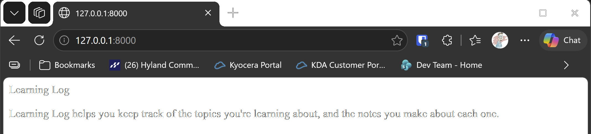

# The Home Page

## What this step does

Until now, the project has only had the admin site. This step gives Learning Log its own front page, which is the first
page a visitor sees at `http://127.0.0.1:8000/`.

Making a page takes three pieces, and they work together:

- **URL:** the address, such as `/`. The URL file says which code should answer it.
- **View:** the Python function that runs when the address is visited. It decides what to show.
- **Template:** the HTML that the view fills in and sends back to the browser.

## If you're using the lesson runner

You don't need the setup steps below. The runner builds the step, creates your admin account if you haven't already this session, and loads any example data this step needs.

1. In the steps list on the left, choose **Ch18 · Getting started with django**, then **The Home Page**.
2. Click **Run**.
3. The browser opens at `http://127.0.0.1:8000/`. You should see the words **Learning Log** and one sentence about keeping track of what you learn.
4. The page is unstyled, which is expected at this stage.
5. Press **Escape** to stop the server when you're done. Moving to another step also stops it.

## For dummies: the quick version

1. In PowerShell, go to the `web-applications` folder, and make sure `(.venv)` is at the start of the line.
2. Type `python build_stage.py ch18 4 --run` and press Enter. You should see `Ran 11 tests` and `OK`.
3. Wait for the line `Starting development server at http://127.0.0.1:8000/`.
4. Open a browser, and go to `http://127.0.0.1:8000/`. You should see the words **Learning Log**, and a sentence about
   keeping track of what you learn.
5. Take the screenshot, using the steps in the next section.
6. Back in PowerShell, press Ctrl+C to stop the server.

You don't need to make an account again for this step, because the home page doesn't need one.

### Screenshot setup, step by step

Use these settings for every screenshot in this chapter, so the pictures all look the same.

1. Open the browser, and maximize the window by double-clicking the title bar at the top.
2. Press **Ctrl+0**. This resets the zoom to 100%, so the text is the normal size.
3. Go to `http://127.0.0.1:8000/`, and make sure the address bar at the top shows that address.
4. Press **Windows key + Shift + S**. The screen dims, and a small menu appears at the top.
5. Choose **Rectangular snip** in that menu. Then drag from the top-left corner of the browser window, above the tab
   bar, to the bottom-right corner of the window. The picture should include the address bar and the whole page.
6. Let go of the mouse. A notification appears in the bottom-right corner of the screen. Click it to open **Snipping Tool**.
7. In Snipping Tool, click the **Save** icon (the floppy disk) or press **Ctrl+S**.
8. In the save window, go to this folder, which is the step's `lesson-images` folder:

   ```
   C:\Development\training\training-python\part-ii-projects\web-applications\ch18-getting-started-with-django\lessons\04-home-page\lesson-images
   ```

9. Type `home-page.png` as the file name. Make sure **Save as type** is **PNG**, and click **Save**.
10. Check the picture by looking in the folder. You should see `home-page.png` there.

If you don't see Snipping Tool after step 6, search for "Snipping Tool" in the Start menu, open it, and take the picture
again with **New**, then **Save**.

## The code

`learning_logs/urls.py` is the app's address list. It says that the empty address, `/`, goes to the `index` view:

```python
app_name = "learning_logs"

urlpatterns = [
    path("", views.index, name="index"),
]
```

`learning_logs/views.py` is the view. It asks Django to fill in a template and send it back:

```python
def index(request):
    """The home page for Learning Log."""
    return render(request, "learning_logs/index.html")
```

`learning_logs/templates/learning_logs/index.html` is the page itself. It's ordinary HTML, with no Python in it yet:

```html
<p>Learning Log</p>

<p>Learning Log helps you keep track of the topics you're learning about, and the notes you make about each one.</p>
```

`ll_project/urls.py` includes the app's addresses, so they work in the whole project. The admin route is still there:

```python
urlpatterns = [
    path("admin/", admin.site.urls),
    path("", include("learning_logs.urls")),
]
```

`include()` means "use the addresses from that file as well". Without it, Django would never look in `learning_logs/urls.py`.

## Testing this step

The two new tests in `learning_logs/tests.py` check that the home page loads, using its own template, and that it shows
the words Learning Log. The build runs all eleven tests, and you should see `Ran 11 tests` and `OK`.

## Output

The Learning Log home page at `http://127.0.0.1:8000/`, with the address bar visible.



## Words you'll see

- **URL:** the address in the browser, such as `/`.
- **View:** a Python function that answers a request.
- **Template:** an HTML file that the view fills in.
- **`include()`:** adds one file's addresses to the project's list.

## Changed files

- `learning_logs/urls.py` (new): the app's addresses
- `learning_logs/views.py` (new): the home page view
- `learning_logs/templates/learning_logs/index.html` (new): the home page
- `ll_project/urls.py`: includes the app's addresses
- `learning_logs/tests.py`: adds tests for the home page

---
