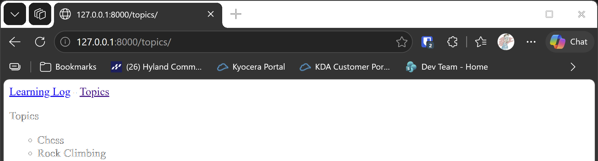

# The Topics Page

## What this step does

Learning Log now has a second page, which lists every topic. The two pages share the same top bar, with links to the home
page and the topics page. Writing the top bar once, and using it on every page, is called **template inheritance**.

## If you're using the lesson runner

You don't need the setup steps below. The runner builds the step, creates your admin account if you haven't already this session, and loads any example data this step needs.

1. In the steps list on the left, choose **Ch18 · Getting started with django**, then **The Topics Page**.
2. Click **Run**.
3. The browser opens at `http://127.0.0.1:8000/topics/`. You should see the top bar with **Learning Log** and **Topics**, and two topics: **Chess** and **Rock Climbing**.
4. The two topics are example data, loaded by the runner, so you don't need to add them yourself.
5. Press **Escape** to stop the server when you're done. Moving to another step also stops it.

## For dummies: the quick version

1. In PowerShell, go to the `web-applications` folder, and make sure `(.venv)` is at the start of the line.
2. Type `python build_stage.py ch18 5 --run` and press Enter. You should see `Ran 13 tests` and `OK`.
3. In a second PowerShell window, make an admin account in the new build, because each build has a new database:

   ```pwsh
   cd build\ch18-getting-started-with-django-step-05
   python manage.py createsuperuser
   ```

4. In the browser, go to `http://127.0.0.1:8000/admin/` and sign in.
5. Click **Topics**, then **Add topic**. Add `Chess`, then add `Rock Climbing`.
6. Go to `http://127.0.0.1:8000/topics/`. Both topics should be listed.
7. Back in the first PowerShell window, press Ctrl+C to stop the server.

### Words you'll see

- **Template inheritance:** a page that starts from a shared base page, and fills in only its own part.
- **Base template:** the shared page, `base.html`. It holds the top bar, and a `block` where each page puts its own content.
- **Block:** a named gap in the base page. Child pages fill it in.
- **Tag:** the code in `` or `{{ }}` brackets. Django replaces it with something when the page is made.

## The code

`learning_logs/templates/learning_logs/base.html` is the shared page. The top bar is written once here, and the `content`
block is the gap that each page fills in:

```html
<p>
  <a href="">Learning Log</a> -
  <a href="">Topics</a>
</p>


```

`` turns a name into the address of that page. If the address ever changes, the link still
works, because the link follows the name, not the address.

`index.html` now extends the base page. It only needs to say what is different about the home page:

```html



  <p>Learning Log helps you keep track of the topics you're learning about, and the notes you make about each one.</p>

```

`topics.html` extends the base page in the same way. The `` tag loops over the topics. The `` part shows
a message when there are none:

```html



  <p>Topics</p>

  <ul>
    
      <li>{{ topic.text }}</li>
    
      <li>No topics have been added yet.</li>
    
  </ul>

```

`views.py` gets the topics from the database, sorted by the date they were added, and passes them to the template:

```python
def topics(request):
    """Show every topic, in the order they were added."""
    topics = Topic.objects.order_by("date_added")
    context = {"topics": topics}
    return render(request, "learning_logs/topics.html", context)
```

`context` is a dictionary. Its keys are the names the template uses, so `topics` in the template is the list from the view.

`urls.py` adds the address `/topics/`, and gives it the name `topics`:

```python
path("topics/", views.topics, name="topics"),
```

## Testing this step

The two new tests check that the topics page loads with its own template, and that the topics you add appear on it. The build
runs all thirteen tests, and you should see `Ran 13 tests` and `OK`.

## Output

The topics page at `http://127.0.0.1:8000/topics/`, with the two topics you added.



## Changed files

- `learning_logs/templates/learning_logs/base.html` (new): the shared top bar and content block
- `learning_logs/templates/learning_logs/index.html`: now extends the base page
- `learning_logs/templates/learning_logs/topics.html` (new): the topics list
- `learning_logs/urls.py`: adds the topics address
- `learning_logs/views.py`: adds the topics view
- `learning_logs/tests.py`: adds tests for the topics page

---
