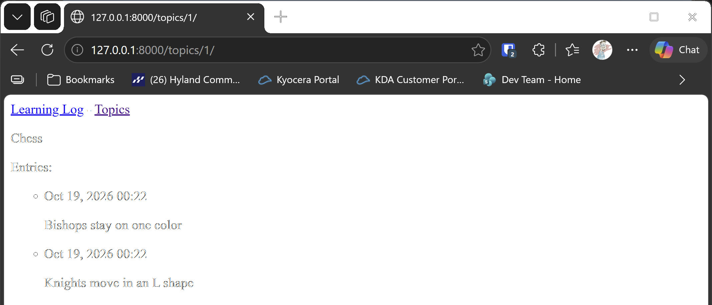

# Individual Topic Pages

## What this step does

Each topic gets a page of its own, at its own address, such as `/topics/1/`. The page shows the topic's name, followed by
its notes, newest first. The topics page now links to each topic, so a visitor can click through to the notes.

Each topic's address has a number in it. That number is the topic's **id**, which Django gives every row in the database.
The page looks the topic up by its id, and shows an error page if there's no topic with that id.

## If you're using the lesson runner

You don't need the setup steps below. The runner builds the step, creates your admin account if you haven't already this session, and loads any example data this step needs.

1. In the steps list on the left, choose **Ch18 · Getting started with django**, then **Individual Topic Pages**.
2. Click **Run**.
3. The browser opens at `http://127.0.0.1:8000/topics/1/`, which is the Chess topic.
4. You should see two entries, with the newest first: **Bishops stay on one color.** and then **Knights move in an L shape.**
5. Press **Escape** to stop the server when you're done. Moving to another step also stops it.

## For dummies: the quick version

1. In PowerShell, go to the `web-applications` folder, and make sure `(.venv)` is at the start of the line.
2. Type `python build_stage.py ch18 6 --run` and press Enter. You should see `Ran 17 tests` and `OK`.
3. In a second PowerShell window, make an admin account in the new build, because each build has a new database:

   ```pwsh
   cd build\ch18-getting-started-with-django-step-06
   python manage.py createsuperuser
   ```

4. In the browser, go to `http://127.0.0.1:8000/admin/` and sign in.
5. Add two topics, `Chess` and `Rock Climbing`, under **Topics**, if you haven't already.
6. Click **Entries**, then **Add entry**. Choose `Chess` as the topic, type `Knights move in an L shape.`, and click **Save**.
   Add a second entry for `Chess`, such as `Bishops stay on one color.`
7. Go to `http://127.0.0.1:8000/topics/`. Click **Chess**. You should see both entries, with the newest first.
8. Back in the first PowerShell window, press Ctrl+C to stop the server.

### Words you'll see

- **id:** the number Django gives each row. The first topic has id 1, the second id 2, and so on.
- **URL parameter:** a part of an address that changes, such as the `1` in `/topics/1/`. The view receives it.
- **404:** the error a browser gets when the page doesn't exist. Django shows a 404 page for a topic that isn't there.
- **`linebreaks`:** a filter that turns the line breaks in an entry into paragraphs on the page.

## The code

`learning_logs/urls.py` adds an address that includes the topic's id. The `<int:topic_id>` part means "a whole number, which
the view will call `topic_id`":

```python
path("topics/<int:topic_id>/", views.topic, name="topic"),
```

`learning_logs/views.py` finds the topic and its entries. `get_object_or_404` returns the topic, or gives a 404 page if it
doesn't exist. `order_by("-date_added")` puts the newest entry first:

```python
def topic(request, topic_id):
    """Show one topic and all of its entries, newest first."""
    topic = get_object_or_404(Topic, id=topic_id)
    entries = topic.entry_set.order_by("-date_added")
    context = {"topic": topic, "entries": entries}
    return render(request, "learning_logs/topic.html", context)
```

`topic.entry_set` is how Django finds the entries that belong to a topic. It works because each entry has a foreign key to its
topic, from step 3.

`learning_logs/templates/learning_logs/topic.html` shows the topic and its entries:

```html
<p>{{ topic.text }}</p>

<p>Entries:</p>

<ul>
  
    <li>
      <p>{{ entry.date_added|date:"M d, Y H:i" }}</p>
      <p>{{ entry.text|linebreaks }}</p>
    </li>
  
    <li>There are no entries for this topic yet.</li>
  
</ul>
```

`topics.html` now links each topic to its page. `` builds the address from the name and the id:

```html
<li><a href="">{{ topic.text }}</a></li>
```

## Testing this step

The four new tests check that a topic page loads, that it shows the topic's entries, that a topic that doesn't exist gives a
404 page, and that the topics page links to each topic. The build runs all seventeen tests, and you should see
`Ran 17 tests` and `OK`.

## Output

The page for the Chess topic, at `http://127.0.0.1:8000/topics/`, with its entries shown below the topic name.



## Changed files

- `learning_logs/urls.py`: adds the topic page address
- `learning_logs/views.py`: adds the topic view
- `learning_logs/templates/learning_logs/topic.html` (new): the topic page
- `learning_logs/templates/learning_logs/topics.html`: links each topic to its page
- `learning_logs/tests.py`: adds tests for the topic pages
