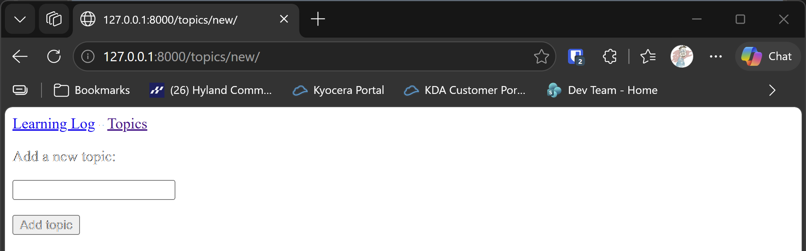

# The New Topic Form

## What this step does

Until now, topics could only be added through the admin site. This step gives Learning Log its own form for adding a
topic. A visitor clicks **Add a new topic** on the topics page, types a name, and clicks the button. The topic is saved, and
the visitor is sent back to the topics page, where the new topic appears.

A form does two jobs. When the page is first opened, it shows a blank box. When the visitor clicks the button, the form sends
what they typed back to the server, which checks it and saves it.

## If you're using the lesson runner

You don't need the setup steps below. The runner builds the step, creates your admin account if you haven't already this session, and loads any example data this step needs.

1. In the steps list on the left, choose **Ch18 · Getting started with django**, then **The New Topic Form**.
2. Click **Run**.
3. The browser opens at `http://127.0.0.1:8000/topics/new/`, the form for adding a topic.
4. Type a topic, such as **Gardening**, and click **Add topic**. You should be sent back to the topics page, with your topic in the list.
5. Press **Escape** to stop the server when you're done. Moving to another step also stops it.

## For dummies: the quick version

1. In PowerShell, go to the `web-applications` folder, and make sure `(.venv)` is at the start of the line.
2. Type `python build_stage.py ch18 7 --run` and press Enter. You should see `Ran 20 tests` and `OK`.
3. In a second PowerShell window, make an admin account in the new build, because each build has a new database:

   ```pwsh
   cd build\ch18-getting-started-with-django-step-07
   python manage.py createsuperuser
   ```

4. In the browser, go to `http://127.0.0.1:8000/topics/`.
5. Click **Add a new topic**. Type `Gardening` in the box, and click **Add topic**.
6. You should be sent back to the topics page, with **Gardening** in the list.
7. Click **Add a new topic** again, leave the box empty, and click **Add topic**. The form should show again, and no
   topic is added.
8. Back in the first PowerShell window, press Ctrl+C to stop the server.

### Words you'll see

- **Form:** a set of boxes and a button that send data to the server.
- **ModelForm:** a form that's built from a model. Django works out the boxes from the model's fields, so you don't
  write each one by hand.
- **POST:** the way a form sends its data. A visitor opening a page makes a GET request, and clicking a form's button
  makes a POST request.
- **CSRF token:** a hidden code the form sends with its data, to prove the form came from your own site.
- **Redirect:** sending the browser on to another page after a save.

## The code

`learning_logs/forms.py` builds the form from the `Topic` model. It only shows the `text` field, because the date is filled
in automatically:

```python
class TopicForm(forms.ModelForm):
    """A form for adding a new topic. It uses the Topic model."""

    class Meta:
        """Which model the form uses, and which of its fields the form shows."""

        model = Topic
        fields = ["text"]
        labels = {"text": ""}
```

`labels` leaves the box without a label, because the sentence above it already says what to type.

`learning_logs/views.py` has a view that handles both kinds of request:

```python
def new_topic(request):
    """Add a new topic. On a GET request, show an empty form. On a POST, save the form if it's valid."""
    if request.method != "POST":
        form = TopicForm()
    else:
        form = TopicForm(data=request.POST)
        if form.is_valid():
            form.save()
            return redirect("learning_logs:topics")

    context = {"form": form}
    return render(request, "learning_logs/new_topic.html", context)
```

- When the page is first opened, the request is a GET, so the view makes a blank form.
- When the button is clicked, the request is a POST, so the view makes a form from the submitted data.
- `form.is_valid()` checks the data. If the box is empty, the form isn't valid, and nothing is saved.
- `form.save()` saves the topic. `redirect()` then sends the visitor to the topics page.

`new_topic.html` shows the form. `` is the hidden code, and `{{ form.as_p }}` fills in the boxes:

```html
<form action="" method="post">
  
  {{ form.as_p }}
  <button name="submit">Add topic</button>
</form>
```

`topics.html` now has a link to the new topic page, above the list:

```html
<p><a href="">Add a new topic</a></p>
```

## Testing this step

The three new tests check that the form page loads, that a valid submission saves the topic and redirects to the list, and that
an empty submission saves nothing. The build runs all twenty tests, and you should see `Ran 20 tests` and `OK`.

## Output

The new topic form, with the **Add topic** button.



## Changed files

- `learning_logs/forms.py` (new): the topic form
- `learning_logs/views.py`: adds the new topic view
- `learning_logs/urls.py`: adds the new topic address
- `learning_logs/templates/learning_logs/new_topic.html` (new): the form page
- `learning_logs/templates/learning_logs/topics.html`: adds the link to the form
- `learning_logs/tests.py`: adds tests for the form

---
