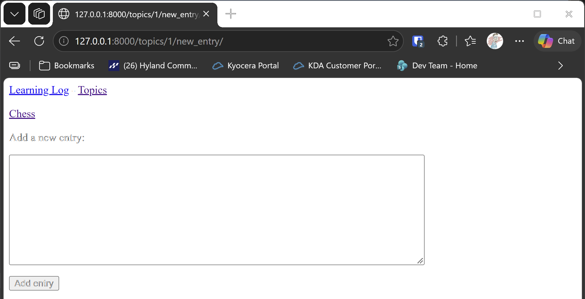

# The New Entry Form

## What this step does

Each topic can now have notes added straight from its own page. Clicking **Add new entry** on a topic page opens a form with a
large text box. When the visitor saves the note, it's stored under that topic, and they're sent back to the topic page, where
the new note is at the top of the list.

This form works like the new topic form from step 7, with one extra piece: the entry has to know which topic it belongs to.

## If you're using the lesson runner

You don't need the setup steps below. The runner builds the step, creates your admin account if you haven't already this session, and loads any example data this step needs.

1. In the steps list on the left, choose **Ch18 · Getting started with django**, then **The New Entry Form**.
2. Click **Run**.
3. The browser opens at `http://127.0.0.1:8000/topics/1/new_entry/`, the form for adding a note to the Chess topic.
4. Type a note, such as **Rooks move in straight lines.**, and click **Add entry**. You should be sent back to the Chess page, with your note at the top of the list.
5. Press **Escape** to stop the server when you're done. Moving to another step also stops it.

## For dummies: the quick version

1. In PowerShell, go to the `web-applications` folder, and make sure `(.venv)` is at the start of the line.
2. Type `python build_stage.py ch18 8 --run` and press Enter. You should see `Ran 24 tests` and `OK`.
3. In a second PowerShell window, make an admin account in the new build, because each build has a new database:

   ```pwsh
   cd build\ch18-getting-started-with-django-step-08
   python manage.py createsuperuser
   ```

4. In the browser, go to `http://127.0.0.1:8000/topics/`, and make sure there's a topic called `Chess`. If there isn't, add one
   with **Add a new topic**.
5. Click **Chess**, then click **Add new entry**.
6. Type a note, such as `Knights move in an L shape.`, and click **Add entry**.
7. You should be sent back to the Chess page, with your note at the top of the list.
8. Back in the first PowerShell window, press Ctrl+C to stop the server.

### Words you'll see

- **Text area:** a box with several lines, for longer text. The form uses one for entries, because a note can be long.
- **`commit=False`:** tells Django to build the entry without saving it yet, so the view can add the topic first.
- **Keyword argument:** a name and a value passed to a function, such as `topic_id=topic.id`. `redirect()` uses one to build
  the address of the topic page.

## The code

`learning_logs/forms.py` adds a form for entries. It's shown on its own here, and the topic form is unchanged:

```python
class EntryForm(forms.ModelForm):
    """A form for adding a new entry to a topic. It uses the Entry model."""

    class Meta:
        """Which model the form uses, which of its fields the form shows, and how the box looks."""

        model = Entry
        fields = ["text"]
        labels = {"text": ""}
        widgets = {"text": forms.Textarea(attrs={"cols": 80})}
```

`widgets` changes how the box looks. `forms.Textarea` is the large box, and `cols` makes it 80 characters wide.

`learning_logs/views.py` has the new view. It takes the topic's id from the address, and the form's data from the request:

```python
def new_entry(request, topic_id):
    """Add a new entry to a topic. The entry is linked to the topic it was written under."""
    topic = get_object_or_404(Topic, id=topic_id)

    if request.method != "POST":
        form = EntryForm()
    else:
        form = EntryForm(data=request.POST)
        if form.is_valid():
            new_entry = form.save(commit=False)
            new_entry.topic = topic
            new_entry.save()
            return redirect("learning_logs:topic", topic_id=topic.id)

    context = {"topic": topic, "form": form}
    return render(request, "learning_logs/new_entry.html", context)
```

The important part is `commit=False`. It builds the entry in memory, so `new_entry.topic = topic` can set the topic before the entry is
saved. Saving without that would fail, because an entry has to belong to a topic.

`learning_logs/urls.py` adds the address, which includes the topic's id:

```python
path("topics/<int:topic_id>/new_entry/", views.new_entry, name="new_entry"),
```

`new_entry.html` shows the form. It also has a link back to the topic, so the visitor can cancel by going back:

```html
<p><a href="">{{ topic.text }}</a></p>

<form action="" method="post">
  
  {{ form.as_p }}
  <button name="submit">Add entry</button>
</form>
```

`topic.html` now has a link to that form, above the list of entries:

```html
<p><a href="">Add new entry</a></p>
```

## Testing this step

The four new tests check that the entry form loads, that a valid entry is saved under the right topic and the visitor is sent back to
that topic, that an empty entry is rejected, and that the topic page links to the form. The build runs all twenty-four tests, and you
should see `Ran 24 tests` and `OK`.

## Output

The new entry form on a topic's page, with the large text box and the **Add entry** button.



## Changed files

- `learning_logs/forms.py`: adds the entry form
- `learning_logs/views.py`: adds the new entry view
- `learning_logs/urls.py`: adds the new entry address
- `learning_logs/templates/learning_logs/new_entry.html` (new): the entry form page
- `learning_logs/templates/learning_logs/topic.html`: adds the link to the entry form
- `learning_logs/tests.py`: adds tests for the entry form

---
