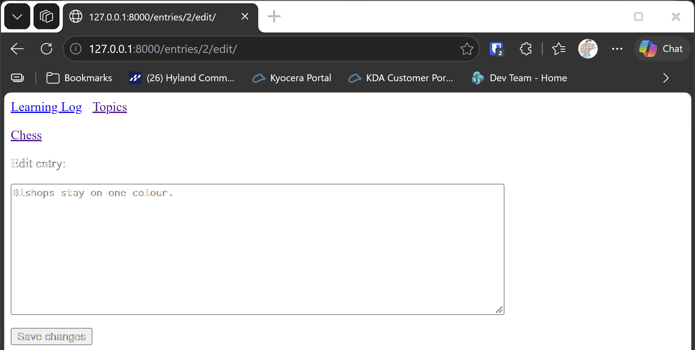

# Editing Entries

## What this step does

Notes can now be corrected. Each entry on a topic page has an **Edit entry** link. Clicking it opens the same form as the new
entry page, but the box already holds the note's current text. The visitor changes the text, clicks **Save changes**, and is sent
back to the topic page, where the change shows at once.

Editing reuses the entry form from step 8, so the form is only written once.

## If you're using the lesson runner

You don't need the setup steps below. The runner builds the step, creates your admin account if you haven't already this session, and loads any example data this step needs.

1. In the steps list on the left, choose **Ch18 · Getting started with django**, then **Editing Entries**.
2. Click **Run**.
3. The browser opens at `http://127.0.0.1:8000/topics/1/`, the Chess topic.
4. Under any note, click **Edit entry**. Change the text, then click **Save changes**.
5. You should be sent back to the Chess page, with the change showing.
6. Press **Escape** to stop the server when you're done. Moving to another step also stops it.

## For dummies: the quick version

1. In PowerShell, go to the `web-applications` folder, and make sure `(.venv)` is at the start of the line.
2. Type `python build_stage.py ch18 9 --run` and press Enter. You should see `Ran 28 tests` and `OK`.
3. In a second PowerShell window, make an admin account in the new build, because each build has a new database:

   ```pwsh
   cd build\ch18-getting-started-with-django-step-09
   python manage.py createsuperuser
   ```

4. In the browser, go to `http://127.0.0.1:8000/topics/`, and click a topic that has an entry. If you don't have one, add an
   entry from **Add new entry**.
5. On the topic page, click **Edit entry** under one of the notes.
6. Change the text, such as adding a full stop at the end, and click **Save changes**.
7. You should be sent back to the topic page, with the new text showing.
8. Back in the first PowerShell window, press Ctrl+C to stop the server.

### Words you'll see

- **Edit:** changing a saved record. Django does it by loading the record, showing it in a form, and saving the changes.
- **`instance`:** the existing record that a form is filled from or saves into. Passing `instance=entry` is what makes the form
  start with the current text.
- **`refresh_from_db()`:** reloads a record from the database. The tests use it to check the saved change.

## The code

`learning_logs/views.py` has the edit view. It works like the new entry view, but it starts from an existing entry:

```python
def edit_entry(request, entry_id):
    """Edit an existing entry. On a GET request, show the form filled in with the entry's text."""
    entry = get_object_or_404(Entry, id=entry_id)
    topic = entry.topic

    if request.method != "POST":
        form = EntryForm(instance=entry)
    else:
        form = EntryForm(instance=entry, data=request.POST)
        if form.is_valid():
            form.save()
            return redirect("learning_logs:topic", topic_id=topic.id)

    context = {"entry": entry, "topic": topic, "form": form}
    return render(request, "learning_logs/edit_entry.html", context)
```

- `EntryForm(instance=entry)` makes a form filled in with the entry's current text, for the first visit.
- `EntryForm(instance=entry, data=request.POST)` makes a form that updates that same entry when it's saved. Without
  `instance=entry`, Django would create a new entry instead of changing this one.
- `topic = entry.topic` gets the topic the entry belongs to, so the view knows where to send the visitor back.

`learning_logs/urls.py` adds the address for one entry, using its id:

```python
path("entries/<int:entry_id>/edit/", views.edit_entry, name="edit_entry"),
```

`edit_entry.html` is the page. It has a link back to the topic, and it sends the form to the edit address for this entry:

```html
<form action="" method="post">
  
  {{ form.as_p }}
  <button name="submit">Save changes</button>
</form>
```

`topic.html` now has an **Edit entry** link under each note:

```html
<p><a href="">Edit entry</a></p>
```

## Testing this step

The four new tests check that the edit page loads with the current text, that saving changes the entry and sends the visitor back
to its topic, that an entry which doesn't exist gives a 404 page, and that each entry on the topic page links to its edit page.
The build runs all twenty-eight tests, and you should see `Ran 28 tests` and `OK`.

## Output

The edit entry page, with the note's current text in the box and the **Save changes** button under it.



## Chapter summary

In this chapter you built Learning Log, a small website for keeping notes about the topics you're learning. You built
it one step at a time, and each step added one idea.

**Projects and apps.** A Django project is the whole website, and an app is one part of it that does one job. The project
holds the settings and the list of addresses. The `learning_logs` app holds the topics, the entries, and the pages for them.

**Models and the database.** A model is a Python class that describes the data an app stores. `Topic` and `Entry` are our two
models. Each entry links to its topic with a foreign key, and deleting a topic deletes its entries. Migrations create and change
the database tables to match the models.

**The admin site.** Registering a model with `admin.site.register()` gives you a page for adding, changing and viewing its
records, with no extra code. You sign in with a superuser account, which you make with `createsuperuser`.

**Pages.** Every page is made of three parts: a URL, a view, and a template. The URL says which view answers an address. The view
finds the data it needs, and passes it to the template. The template is the HTML that the visitor sees.

**Template inheritance.** The top bar is written once, in `base.html`. Each page extends it, and fills in its own block.

**Forms.** A `ModelForm` builds a form from a model. A GET request shows the form. A POST request sends the visitor's data back to
the server, which checks it with `is_valid()`, saves it, and redirects. `commit=False` lets the view add the topic to an entry
before it's saved.

**Editing.** Passing `instance=` to a form fills it with an existing record, and saves the changes to that same record.

**Tests.** Each step added tests for what it built, and the tests ran with every build. Running the same tests at every step
means a change that breaks an earlier page shows up straight away.

**What's left for later.** Deleting entries is left out on purpose. Deleting should only be possible for the owner of an entry, or for
an admin. That needs user accounts, which come in chapter 19. The chapter 18 exercises cover the same ideas on new projects, and
then chapter 19 adds accounts, so each user sees only their own topics.

## Changed files

- `learning_logs/views.py`: adds the edit entry view
- `learning_logs/urls.py`: adds the edit entry address
- `learning_logs/templates/learning_logs/edit_entry.html` (new): the edit page
- `learning_logs/templates/learning_logs/topic.html`: adds the edit link under each entry
- `learning_logs/tests.py`: adds tests for editing entries

---
