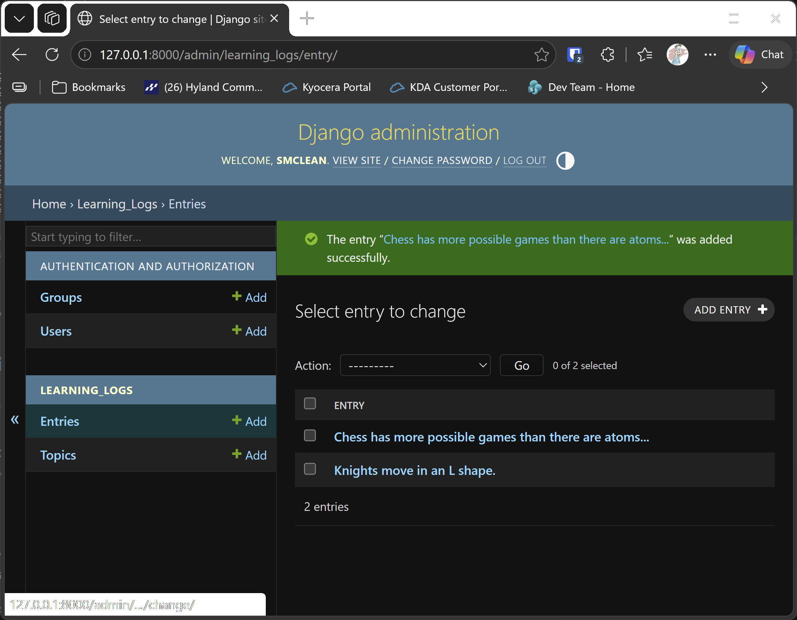

# Exercise 18-2: Short Entries

## The exercise

The `__str__()` method in the `Entry` model currently appends an ellipsis to every instance of `Entry` when Django shows it in the
admin site or the shell. Add an `if` statement to the `__str__()` method that adds an ellipsis only if the entry is longer than 50
characters. Use the admin site to add an entry that's fewer than 50 characters in length, and check that it doesn't have an ellipsis
when viewed.

## About this exercise

The chapter's version of `Entry.__str__()` always adds the ellipsis. This exercise changes it to add the ellipsis only for long entries.

In the course project, the change is already made in `learning_logs/models.py`, from step 3 of the lessons. So the code below is the
answer to the exercise, and you can check it against the project. If you're working through the exercise on your own copy of the
chapter's code, make the change yourself.

## The solution

`learning_logs/models.py`:

```python
    def __str__(self) -> str:
        """Return a short preview of the entry's text."""
        if len(self.text) > 50:
            return f"{self.text[:50]}..."
        return self.text
```

## Checking it

1. Start the project with `python build_stage.py ch18 3 --run`, or with the runner, and sign in to the admin site.
2. Under **Entries**, add an entry with fewer than 50 characters, such as `Knights move in an L shape.`
3. Click the entry in the list. Its name in the list should show the full text, with no ellipsis.
4. Add a second entry with more than 50 characters. Its name in the list should show the first 50 characters, followed by `...`.
5. Open the Django shell with `python manage.py shell`, and type `from learning_logs.models import Entry`, then `str(Entry.objects.first())`
   to see the same result in the shell.

The tests in `learning_logs/tests.py` check both cases: a long entry is shortened with an ellipsis, and a short entry is shown in full.

## Output

The admin list with one short entry shown in full, and one long entry shown with its ellipsis.



---
