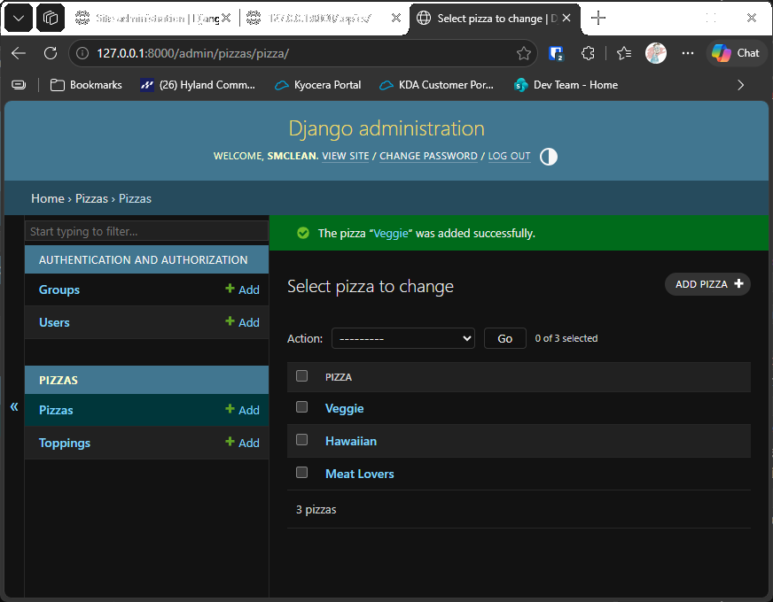

# Exercise 18-4: Pizzeria

## The exercise

Start a new project called `pizzeria_project` with an app called `pizzas`. Define a model `Pizza` with a field called `name`, which
will hold name values, such as Hawaiian and Meat Lovers. Define a model called `Topping` with fields called `pizza` and `name`. The
`pizza` field should be a foreign key to `Pizza`, and `name` should be able to hold values such as pineapple, Canadian bacon, and
sausage. Register both models with the admin site, and use the site to enter some pizza names and toppings. Use the shell to explore
the data you entered.

## If you're using the lesson runner

In the steps list, open **Ch18 · Getting started with django**, then **Try it Yourself**, then **Exercise 18-4: Pizzeria**, and click **Run**. The runner builds the project, creates your admin account if needed, runs the tests, and starts the server. The browser opens at the admin page. You'll need to add the pizzas and toppings yourself, as the exercise describes.

## Running this exercise

Use the chapter's virtual environment, from the `web-applications` folder, with Django installed (see chapter 18, step 1).

1. Go to the exercise folder, and migrate the database:

   ```pwsh
   cd try-it-yourself\18-4-pizzeria
   python manage.py migrate
   ```

2. Create an admin account:

   ```pwsh
   python manage.py createsuperuser
   ```

3. Start the server with `python manage.py runserver`, and go to `http://127.0.0.1:8000/admin/`. Sign in.
4. Under **Pizzas**, add `Hawaiian` and `Meat Lovers`.
5. Under **Toppings**, add `pineapple` and `Canadian bacon` for Hawaiian, and `sausage` for Meat Lovers. Use the **Pizza** field to
   choose which pizza each topping belongs to.
6. Stop the server with Ctrl+C. Then open the shell with `python manage.py shell`, and try:

   ```python
   from pizzas.models import Pizza, Topping
   Pizza.objects.all()
   hawaiian = Pizza.objects.get(name="Hawaiian")
   hawaiian.topping_set.all()
   Topping.objects.filter(name="sausage")
   ```

To run the tests, use `python manage.py test`.

## The code

`pizzas/models.py` defines the two models. A topping points at its pizza with a foreign key, so the database keeps each topping
with the pizza it belongs to:

```python
class Pizza(models.Model):
    """A named pizza on the menu, such as Hawaiian or Meat Lovers."""

    name = models.CharField(max_length=30)


class Topping(models.Model):
    """One topping on a pizza, such as pineapple or sausage."""

    pizza = models.ForeignKey(Pizza, on_delete=models.CASCADE)
    name = models.CharField(max_length=30)
```

`pizzas/admin.py` registers both models, so you can add them in the browser:

```python
admin.site.register(Pizza)
admin.site.register(Topping)
```

`pizzas/migrations/0001_initial.py` creates both tables. Django writes this file with `makemigrations`. It's included here so
`migrate` can create the tables without an extra step.

## Testing this exercise

The tests in `pizzas/tests.py` check that each model displays its name, that a topping belongs to its pizza, that deleting a pizza
deletes its toppings, and that both lists appear in the admin site. Run them with `python manage.py test`, and you should see
`Ran 6 tests` and `OK`.

## Output

The Pizzas list in the admin site, showing Hawaiian and Meat Lovers.



## Changed files

- `pizzeria_project/`: the project settings, URLs, WSGI and ASGI files
- `pizzas/`: the app, with its models, admin registration, migration and tests
- `manage.py`: the command-line tool
