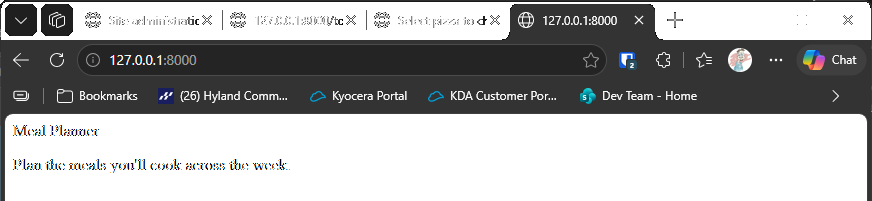

# Exercise 18-5: Meal Planner

## The exercise

Consider an app that helps people plan their meals throughout the week. Make a new folder called `meal_planner`, and start a new Django
project inside this folder. Then make a new app called `meal_plans`. Make a simple home page for this project.

## If you're using the lesson runner

In the steps list, open **Ch18 · Getting started with django**, then **Try it Yourself**, then **Exercise 18-5: Meal Planner**, and click **Run**. The browser opens at the Meal Planner home page.

## Running this exercise

1. Use the chapter's virtual environment, with Django installed (see chapter 18, step 1). Go to the exercise folder:

   ```pwsh
   cd try-it-yourself\18-5-meal-planner
   ```

2. Run the tests, which check the home page:

   ```pwsh
   python manage.py test
   ```

   You should see `Ran 2 tests` and `OK`.

3. Start the server with `python manage.py runserver`, and go to `http://127.0.0.1:8000/`. You should see **Meal Planner** and one sentence
   about planning meals. Press Ctrl+C to stop the server.

## How it's laid out

- **`meal_planner/`:** the project. It holds the settings, the list of addresses, and the WSGI file. It's the same kind of project you made in
  exercise 18-1.
- **`meal_plans/`:** the app. Its `views.py` has the home page view, its `urls.py` has the address for it, and its `templates/` folder has the page.
- **`meal_planner/urls.py`:** includes the app's addresses at the empty address, so the home page is the first page you see.

## Solution

The project is in this folder. The key files are below.

`meal_plans/views.py` renders the home page:

```python
def index(request):
    """The home page for the meal planner."""
    return render(request, "meal_plans/index.html")
```

`meal_planner/urls.py` includes the app's addresses:

```python
path("", include("meal_plans.urls")),
```

## Output

The Meal Planner home page at `http://127.0.0.1:8000/`, with its title and one sentence.



---
