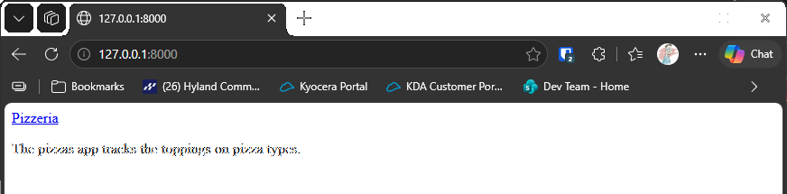

# Exercise 18-6: Pizzeria Home Page

## The exercise

Add a home page to the Pizzeria project you started in exercise 18-4.

## If you're using the lesson runner

In the steps list, open **Ch18 · Getting started with django**, then **Try it Yourself**, then **Exercise 18-6: Pizzeria Home Page**, and click **Run**. The runner builds the Pizzeria from exercise 18-4 with these changes, and the browser opens at the home page.

## Running this exercise

This exercise changes the Pizzeria project from 18-4. The folder for this exercise holds only the files that change, so
you copy the 18-4 project first, then copy these files over it.

1. Copy the `18-4-pizzeria` folder to a new folder, such as `18-6-pizzeria`.
2. Copy the contents of this exercise's folder over the new folder. Say yes to replace the files with the same names:

   ```pwsh
   cd try-it-yourself
   Copy-Item -Recurse 18-4-pizzeria 18-6-pizzeria
   Copy-Item -Recurse -Force 18-6-pizzeria-home-page\* 18-6-pizzeria
   cd 18-6-pizzeria
   ```

3. Run the tests. You should see `Ran 8 tests` and `OK`:

   ```pwsh
   python manage.py test
   ```

4. Start the server with `python manage.py runserver`, and go to `http://127.0.0.1:8000/`. You should see **Pizzeria** at the top, and
   one sentence about the pizzas app.

## The code

The Pizzeria follows the same three-part pattern as the Learning Log: a URL, a view, and a template.

`pizzas/views.py` has the home page view:

```python
def index(request):
    """The home page for the Pizzeria."""
    return render(request, "pizzas/index.html")
```

`pizzas/urls.py` gives the empty address a name:

```python
path("", views.index, name="index"),
```

`pizzeria_project/urls.py` includes the app's addresses, so the home page works in the whole project:

```python
path("", include("pizzas.urls")),
```

`pizzas/templates/pizzas/base.html` is the shared top bar. Each page extends it, as in the Learning Log.

## Output

The Pizzeria home page at `http://127.0.0.1:8000/`, with the top bar and one sentence.



---
