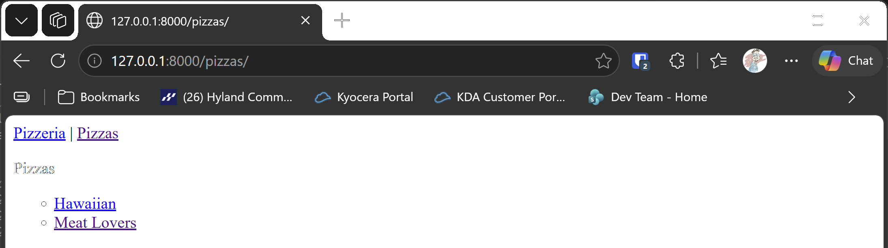
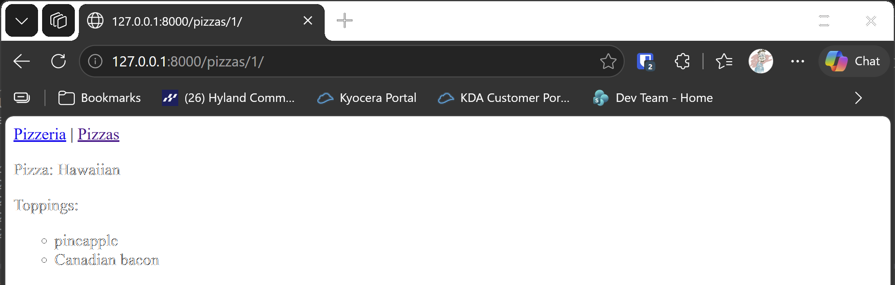

# Exercise 18-8: Pizzeria Pages

## The exercise

Add a page to the Pizzeria project from exercise 18-6 that shows the names of available pizzas. Then link each pizza name to a page
displaying the pizza's toppings. Make sure you use template inheritance to build your pages efficiently.

## If you're using the lesson runner

In the steps list, open **Ch18 · Getting started with django**, then **Try it Yourself**, then **Exercise 18-8: Pizzeria Pages**, and click **Run**. The runner builds the Pizzeria from exercises 18-4 and 18-6, adds these pages, and loads the example pizzas. The browser opens at the pizzas list, which shows Hawaiian and Meat Lovers.

## Running this exercise

This exercise changes the Pizzeria project from 18-6. The folder holds only the files that change, so you copy the 18-6 project first, then
copy these files over it.

1. Make a copy of the 18-6 project, such as `18-8-pizzeria`, and copy this exercise's files over it:

   ```pwsh
   cd try-it-yourself
   Copy-Item -Recurse 18-6-pizzeria 18-8-pizzeria
   Copy-Item -Recurse -Force 18-8-pizzeria-pages\* 18-8-pizzeria
   cd 18-8-pizzeria
   ```

   If you don't have the 18-6 project as a folder, make the copy first by following the steps in the 18-6 lesson.

2. Run the tests. You should see `Ran 12 tests` and `OK`:

   ```pwsh
   python manage.py test
   ```

3. Start the server with `python manage.py runserver`. Go to `http://127.0.0.1:8000/pizzas/`. You should see the list of pizzas, and
   each name links to its toppings page. The top bar has a **Pizzas** link too.

The runner loads example data for this exercise: two pizzas, Hawaiian and Meat Lovers, with their toppings. If you build the exercise by hand, the list is empty until you add pizzas in the admin site, as you did in exercise 18-4.

## How the pages fit together

Both new pages extend `base.html`, so they share the top bar. Only the content block is different on each page. That's template inheritance.

- `pizzas.html` loops over the pizzas, and links each name to its page.
- `pizza.html` shows the pizza's name, then loops over its toppings.
- `views.py` has one view for each page. `pizza` looks the pizza up by its id, and returns a 404 page if it doesn't exist.
- `urls.py` gives each page an address, with the pizza's id in the second one.

## The code

`pizzas/urls.py` has the two new addresses. The second one includes the pizza's id:

```python
path("pizzas/", views.pizzas, name="pizzas"),
path("pizzas/<int:pizza_id>/", views.pizza, name="pizza"),
```

`pizzas/templates/pizzas/pizzas.html` links each pizza to its page with ``:

```html

  <li>
    <a href="">{{ pizza }}</a>
  </li>

  <li>No pizzas have been added yet.</li>

```

`pizzas/templates/pizzas/pizza.html` shows the toppings for one pizza, with the same loop pattern as the topic page in the Learning Log.

## Output

The list of pizzas at `http://127.0.0.1:8000/pizzas/`, with Hawaiian and Meat Lovers.



The toppings page for Hawaiian, at `http://127.0.0.1:8000/pizzas/1/`, showing pineapple and Canadian bacon.


