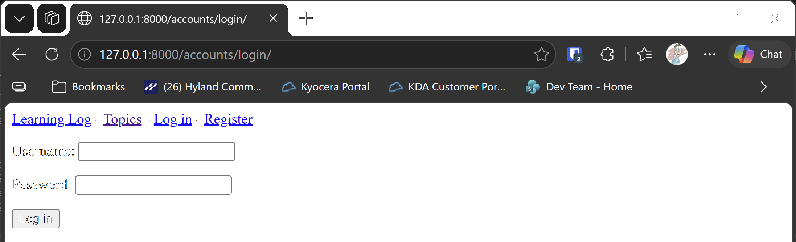
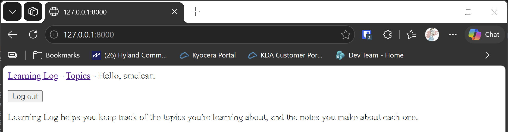

# User Accounts

## What this step does

Until now, anyone who visits Learning Log can see and change every topic and entry. This step adds accounts, so visitors can
register, sign in and sign out. Each visitor can see who they're signed in as.

Django gives us most of this for free. The login and logout pages come from Django's authentication system, and we add a
registration page and a link in the top bar. The topics and entries aren't restricted yet. That's the next step.

## If you're using the lesson runner

In the steps list, open **Ch19 · User accounts**, then **User Accounts**, and click **Run**. The runner builds the project, and
creates your admin account if it hasn't already this session. The browser opens at the login page.

1. Sign in with the username and password you chose in the runner.
2. The top bar should say **Hello**, followed by your username, with a **Log out** button.
3. Click **Log out**. The top bar shows **Log in** and **Register** again.
4. Click **Register**, make a second account, and check that it signs you in straight away.

Press **Escape** to stop the server when you're done.

## For dummies: the quick version

1. In PowerShell, go to the `web-applications` folder, and make sure `(.venv)` is at the start of the line.
2. Type `python build_stage.py ch19 1 --run` and press Enter. You should see `Ran 33 tests` and `OK`.
3. The browser opens at `http://127.0.0.1:8000/accounts/login/`. Sign in with the account you made in the runner.
4. Click **Log out**, then **Register**, and make a new account.
5. Back in the first PowerShell window, press Ctrl+C to stop the server.

### Words you'll see

- **Authentication:** checking who someone is. Signing in is authentication.
- **Session:** Django's record that a visitor is signed in. It's kept between page visits.
- **`user`:** the signed-in visitor, available in every template. A visitor who isn't signed in is an anonymous user.
- **Hashing:** storing a scrambled form of a password, so the password itself is never kept.

## The code

`ll_project/settings.py` adds the accounts app, and sets where to go after signing in and out:

```python
LOGIN_REDIRECT_URL = "learning_logs:index"
LOGOUT_REDIRECT_URL = "learning_logs:index"
```

`ll_project/urls.py` includes the accounts addresses under `accounts/`:

```python
path("accounts/", include("accounts.urls")),
```

`accounts/urls.py` includes Django's built-in login and logout addresses, and adds our registration page:

```python
urlpatterns = [
    path("", include("django.contrib.auth.urls")),
    path("register/", views.register, name="register"),
]
```

`accounts/views.py` has the registration view. It uses Django's `UserCreationForm`, which checks the username and password, and
hashes the password before it's saved. If the form is valid, it signs the new user in:

```python
def register(request):
    """Create a new account, and sign the new user in. On a GET request, show an empty form."""
    if request.method != "POST":
        form = UserCreationForm()
    else:
        form = UserCreationForm(data=request.POST)
        if form.is_valid():
            new_user = form.save()
            login(request, new_user)
            return redirect("learning_logs:index")

    context = {"form": form}
    return render(request, "registration/register.html", context)
```

The login and logout pages use the templates in `accounts/templates/registration/`. Django looks for these by name, which is why
the folder is called `registration`.

`learning_logs/templates/learning_logs/base.html` changes the top bar, depending on whether a visitor is signed in:

```html

  Hello, {{ user.username }}.
  <form action="" method="post" style="display: inline;">
    
    <button name="submit">Log out</button>
  </form>

  <a href="">Log in</a> -
  <a href="">Register</a>

```

Logging out is a form that sends a POST request, not a link. Django requires this, so that another site can't log a visitor out
by sending them to a link.

## Testing this step

The five tests in `accounts/tests.py` check that the login page loads, that registering creates the account and signs the new user
in, that logging out ends the session, and that the top bar greets a signed-in user and offers login links to everyone else. The build
runs all thirty-three tests, and you should see `Ran 33 tests` and `OK`.

## Output

The login page at `http://127.0.0.1:8000/accounts/login/`, before anyone has signed in. The top bar shows Log in and Register.



After signing in, the top bar greets you by name, and offers Log out.



## Changed files

- `accounts/`: the new app, with its URLs, views, templates and tests
- `ll_project/settings.py`: adds the accounts app, and the redirect settings
- `ll_project/urls.py`: includes the accounts addresses
- `learning_logs/templates/learning_logs/base.html`: the sign-in links and the log out button

---
