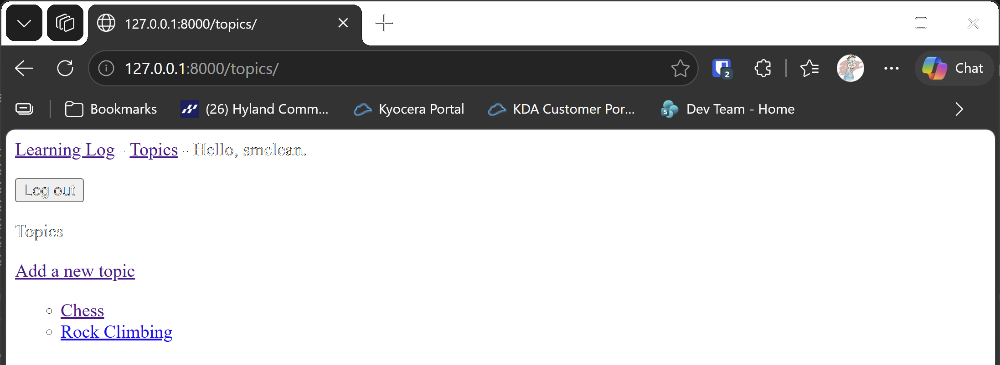

# Allowing Users to Own Their Data

## What this step does

Each topic now belongs to the user who created it. The topic records its owner, and creating a topic requires signing in. A
visitor who isn't signed in is sent to the login page.

Ownership is the basis for the access control in the next step. Once every topic has an owner, the pages can show each user
only their own topics.

## If you're using the lesson runner

In the steps list, open **Ch19 · User accounts**, then **Allowing Users to Own Their Data**, and click **Run**. The runner creates
your admin account first, so it becomes user 1. The example topics, Chess and Rock Climbing, are owned by that account.

1. The browser opens at the login page. Sign in with the account from the runner, then go to the topics page.
2. Click **Add a new topic**, type `Gardening`, and click **Add topic**.
3. You should be sent back to the topics page, with Gardening in the list.
4. Log out, then go to `http://127.0.0.1:8000/topics/new/`. You should be sent to the login page.

Press **Escape** to stop the server when you're done.

## For dummies: the quick version

1. In PowerShell, go to the `web-applications` folder, and make sure `(.venv)` is at the start of the line.
2. Type `python build_stage.py ch19 2 --run` and press Enter. You should see `Ran 35 tests` and `OK`.
3. Sign in with the account you made in the runner, or, if you're running the build by hand, make an admin account first with
   `python manage.py createsuperuser`. The admin account has to exist before the example topics are loaded, because they belong to user 1.
4. Add a topic, then log out and try to add one again.
5. Back in the first PowerShell window, press Ctrl+C to stop the server.

### Words you'll see

- **Owner:** the user a topic belongs to. Here, a `ForeignKey` to the user model.
- **`login_required`:** a decorator that sends visitors who aren't signed in to the login page.
- **`commit=False`:** builds the topic without saving it, so the view can set its owner first.
- **Default:** the value a new field takes for rows that already exist. Here, that's user 1.

## The code

`learning_logs/models.py` gives each topic an owner:

```python
class Topic(models.Model):
    text = models.CharField(max_length=200)
    date_added = models.DateTimeField(auto_now_add=True)
    owner = models.ForeignKey(User, on_delete=models.CASCADE)
```

`owner` is a foreign key to Django's `User` model. `CASCADE` means that if a user is deleted, their topics are deleted too.

`learning_logs/migrations/0003_topic_owner.py` adds the field. A new database has no topics yet, so the default of user 1 is only
used for a database that already has data. `preserve_default=False` means the default isn't kept for future topics.

`learning_logs/views.py` requires sign-in to add a topic, and records the signed-in user as its owner:

```python
@login_required
def new_topic(request):
    """Add a new topic for the signed-in user. On a GET request, show an empty form."""
    if request.method != "POST":
        form = TopicForm()
    else:
        form = TopicForm(data=request.POST)
        if form.is_valid():
            topic_record = form.save(commit=False)
            topic_record.owner = request.user
            topic_record.save()
            return redirect("learning_logs:topics")

    context = {"form": form}
    return render(request, "learning_logs/new_topic.html", context)
```

`request.user` is the signed-in visitor. `commit=False` lets the view set the owner before the topic is saved, which is needed because
the owner is a required field.

The seed data in `seed.json` gives each example topic `"owner": 1`. The runner creates the admin account before it loads the seed, so
that account is user 1.

## Testing this step

The tests now give every topic an owner. Two are new: a topic records its owner, and a visitor who isn't signed in is sent to the login
page, and no topic is saved. The build runs all thirty-five tests, and you should see `Ran 35 tests` and `OK`.

## Output

The topics page for a signed-in user, with the new topic in the list.



## Changed files

- `learning_logs/models.py`: adds the owner to `Topic`
- `learning_logs/migrations/0003_topic_owner.py`: adds the owner field
- `learning_logs/views.py`: requires sign-in to add a topic, and records the owner
- `learning_logs/tests.py`: gives every topic an owner, and adds tests for ownership and sign-in
- `seed.json`: the example topics, owned by user 1

---
