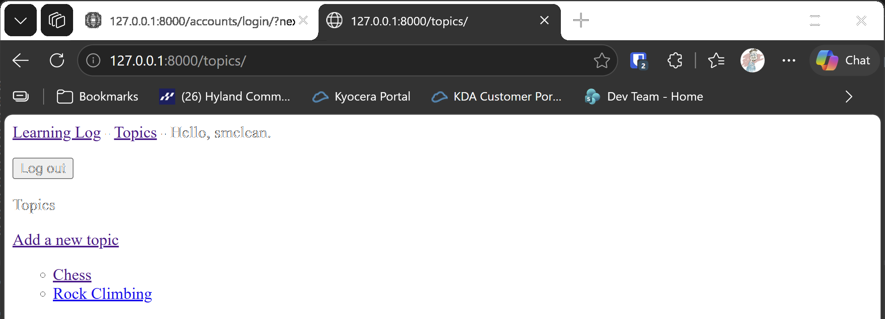

# Restricting Access

## What this step does

Each user can now see only their own topics and entries. The topics page lists only the signed-in user's topics. The topic
page, the new entry page and the edit page check who owns the topic before they show anything.

A visitor who isn't signed in is sent to the login page. A signed-in user who types the address of someone else's topic gets a
404 page, the same as for a topic that doesn't exist. The 404 hides that the topic is there at all.

The home page stays open to everyone, so visitors can still read what Learning Log is about.

## If you're using the lesson runner

In the steps list, open **Ch19 · User accounts**, then **Restricting Access**, and click **Run**. The browser opens at the login page.

1. Sign in with the account from the runner. The topics page shows Chess and Rock Climbing.
2. Click **Log out**, then go to `http://127.0.0.1:8000/topics/`. You should be sent to the login page.
3. Register a second account from the top bar. Its topics page is empty, because it owns no topics yet.
4. Add a topic from the second account, then log out and sign back in with the runner's account. The second account's topic doesn't appear.

Press **Escape** to stop the server when you're done.

## For dummies: the quick version

1. In PowerShell, go to the `web-applications` folder, and make sure `(.venv)` is at the start of the line.
2. Type `python build_stage.py ch19 3 --run` and press Enter. You should see `Ran 41 tests` and `OK`.
3. Sign in with the account you made in the runner, and check that you see Chess and Rock Climbing.
4. Log out, and register a second account. Check that its topics page is empty.
5. Back in the first PowerShell window, press Ctrl+C to stop the server.

### Words you'll see

- **`login_required`:** the decorator that sends a visitor who isn't signed in to the login page.
- **`Http404`:** raises the 404 page. Here it's used when a topic belongs to someone else.
- **`next`:** the address a visitor was trying to reach. Django includes it in the login link, so the visitor can be sent back there.

## The code

Each page that works with a user's data has the same decorator:

```python
@login_required
def topics(request):
    """Show the signed-in user's topics, in the order they were added."""
    topics = Topic.objects.filter(owner=request.user).order_by("date_added")
    context = {"topics": topics}
    return render(request, "learning_logs/topics.html", context)
```

`login_required` runs before the view. If the visitor isn't signed in, it sends them to the login page instead. `filter(owner=request.user)`
keeps only the topics that belong to the signed-in user.

The topic, new entry and edit pages also check the owner, and raise a 404 page if the owner is someone else:

```python
@login_required
def topic(request, topic_id):
    """Show one of the signed-in user's topics and all of its entries, newest first."""
    topic = get_object_or_404(Topic, id=topic_id)
    if topic.owner != request.user:
        raise Http404
    entries = topic.entry_set.order_by("-date_added")
    context = {"topic": topic, "entries": entries}
    return render(request, "learning_logs/topic.html", context)
```

The check comes after `get_object_or_404`, so a topic that doesn't exist and a topic that belongs to someone else both give the same 404 page.
For the edit page, the owner is found through the entry's topic: `topic = entry.topic`.

There's no new migration or seed in this step. The example topics from step 2 still belong to user 1, the runner's account.

## Testing this step

The access tests in `learning_logs/tests.py` check that a visitor who isn't signed in is sent to the login page for the topics page and a topic
page, that the topics page lists only the signed-in user's topics, and that another user gets a 404 page for a topic, a new entry, or an
entry they don't own. The other tests now sign in the owner first. The build runs all forty-one tests, and you should see `Ran 41 tests`
and `OK`.

## Output

The topics page for the runner's account, showing only Chess and Rock Climbing.



## Changed files

- `learning_logs/views.py`: requires sign-in, filters topics by owner, and checks the owner on the topic, new entry and edit pages
- `learning_logs/tests.py`: signs in the owner in each test, and adds the access tests
