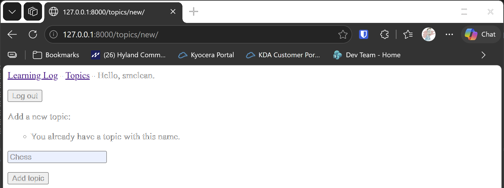

# Duplicate Topics

## What this step does

A user can no longer add two topics with the same name. If you already have a topic called Chess, adding another one shows a message,
and the topic isn't saved. Capital letters don't count, so chess and Chess are the same name.

Names only have to be unique for each user. Another user can have a topic called Chess too.

There are two checks, and each does a different job:

- **The form** checks the name first, and shows a message the visitor can read.
- **The database** has a constraint, so a duplicate is refused even if something skips the form.

## If you're using the lesson runner

In the steps list, open **Ch19 · User accounts**, then **Duplicate Topics**, and click **Run**. The browser opens at the login page.

1. Sign in with the account from the runner, then open **Add a new topic**.
2. Type `Chess` and click **Add topic**. The form stays on the page, with the message **You already have a topic with this name.**
3. Type `chess` in lowercase and click **Add topic**. The same message appears.
4. Type `Gardening` and click **Add topic**. This one is saved, and you're sent back to the topics page.

Press **Escape** to stop the server when you're done.

## For dummies: the quick version

1. In PowerShell, go to the `web-applications` folder, and make sure `(.venv)` is at the start of the line.
2. Type `python build_stage.py ch19 4 --run` and press Enter. You should see `Ran 45 tests` and `OK`.
3. Sign in with the account from the runner, and try adding a topic that already exists. You should see the message, and the topic isn't saved.
4. Back in the first PowerShell window, press Ctrl+C to stop the server.

### Words you'll see

- **Constraint:** a rule the database enforces. Here, a user's topics must have different names.
- **`UniqueConstraint`:** the Django class that defines the rule.
- **`IntegrityError`:** the error the database raises when a constraint is broken. The test checks that it's raised.
- **`iexact`:** a lookup that ignores capital letters. `text__iexact="chess"` matches Chess.

## The code

`learning_logs/models.py` adds the rule to `Topic`:

```python
class Meta:
    constraints = [
        models.UniqueConstraint(fields=["owner", "text"], name="unique_topic_per_owner"),
    ]
```

The rule covers two fields together. Two topics can have the same text if they have different owners, but not for the same owner.
`learning_logs/migrations/0004_unique_topic_per_owner.py` adds the rule to the database. A fresh build has no topics yet, so it
applies cleanly.

`learning_logs/forms.py` checks the name before it's saved:

```python
def clean_text(self) -> str:
    """Reject a name the user already has. Capital letters don't count, so chess and Chess are the same."""
    text = self.cleaned_data["text"].strip()
    if self.owner is not None and Topic.objects.filter(owner=self.owner, text__iexact=text).exists():
        raise forms.ValidationError("You already have a topic with this name.")
    return text
```

Django calls `clean_text` automatically for the `text` field. Raising `ValidationError` shows the message next to the box, and the form isn't saved.
`__init__` receives the owner, because a form on its own doesn't know who is signed in.

`views.py` passes the signed-in user into the form:

```python
form = TopicForm(data=request.POST, owner=request.user)
```

The check uses `text__iexact`, which ignores capital letters. The database constraint is case-sensitive, so the form does the case-insensitive
check, and the database catches exact matches if the form is ever bypassed.

## Testing this step

The four new tests in `learning_logs/tests.py` check that a repeated name is rejected with the message, that capital letters don't get around
the rule, that another user can use the same name, and that the database refuses a duplicate on its own. The build runs all forty-five tests,
and you should see `Ran 45 tests` and `OK`.

## Output

The new topic form, showing the message after a repeated name is entered.



## Changed files

- `learning_logs/models.py`: adds the unique constraint per owner
- `learning_logs/migrations/0004_unique_topic_per_owner.py`: adds the constraint to the database
- `learning_logs/forms.py`: checks the name against the user's topics
- `learning_logs/views.py`: passes the signed-in user to the form
- `learning_logs/tests.py`: adds tests for duplicate names

---
