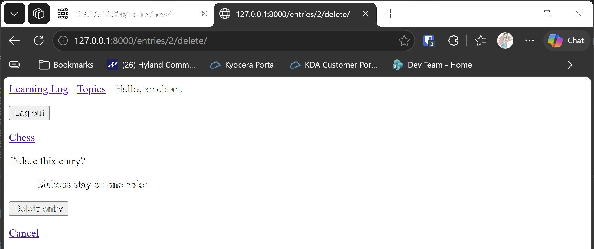

# Deleting Entries

## What this step does

Each entry on a topic page now has a **Delete entry** link. Clicking it opens a confirmation page, which shows the note and asks
whether to delete it. Only when the visitor clicks the **Delete entry** button on that page is the note removed. The visitor is then
sent back to the topic.

Only the owner of the topic can delete its entries. Anyone else who types the address gets a 404 page, the same as for their other
pages.

Admins can already delete entries through the admin site, because the admin site doesn't check owners. This step doesn't change that.
It applies the owner rule to the pages that Learning Log's users see.

## If you're using the lesson runner

In the steps list, open **Ch19 · User accounts**, then **Deleting Entries**, and click **Run**. The browser opens at the login page.

1. Sign in with the account from the runner, then open **Chess**.
2. Under the first note, click **Delete entry**. The confirmation page shows the note.
3. Click **Cancel**. The note is still there.
4. Click **Delete entry** again, then click the **Delete entry** button on the confirmation page. The note is removed.

Press **Escape** to stop the server when you're done.

## For dummies: the quick version

1. In PowerShell, go to the `web-applications` folder, and make sure `(.venv)` is at the start of the line.
2. Type `python build_stage.py ch19 5 --run` and press Enter. You should see `Ran 50 tests` and `OK`.
3. Sign in, open Chess, and delete one note, using the confirmation page.
4. Back in the first PowerShell window, press Ctrl+C to stop the server.

### Words you'll see

- **Confirmation page:** a page that asks the visitor to confirm before something is deleted. It's a safety step, so a stray click can't remove data.
- **POST request:** the kind of request a form sends. Deleting happens only on a POST, so a link can't delete a note.
- **`delete()`:** the model method that removes a row from the database.

## The code

`learning_logs/views.py` has the delete view. It works in two parts: a GET request shows the confirmation page, and a POST request deletes:

```python
@login_required
def delete_entry(request, entry_id):
    """Delete an entry after a confirmation page. Only the owner of the entry's topic can delete it."""
    entry = get_object_or_404(Entry, id=entry_id)
    topic = entry.topic
    if topic.owner != request.user:
        raise Http404

    if request.method == "POST":
        entry.delete()
        return redirect("learning_logs:topic", topic_id=topic.id)

    context = {"entry": entry, "topic": topic}
    return render(request, "learning_logs/delete_entry.html", context)
```

The owner check comes before anything else, so a user who isn't the owner gets a 404 page for both the confirmation and the delete.

`delete_entry.html` shows the note, and the button sends a POST to the delete address:

```html
<form action="" method="post">
  
  <button name="submit">Delete entry</button>
</form>
```

Because the delete is a POST, a link on another site or an image tag can't remove a note. Django's CSRF token also makes sure the POST came from this site.

`learning_logs/urls.py` adds the address for the confirmation and delete page:

```python
path("entries/<int:entry_id>/delete/", views.delete_entry, name="delete_entry"),
```

`topic.html` and `edit_entry.html` each link to the delete page, so the action is available from both places.

## Testing this step

The five new tests in `learning_logs/tests.py` check that the confirmation page loads without deleting anything, that the owner's
confirmation removes the entry, that another user gets a 404 page and the entry stays, that the topic page links to the delete page, and
that a visitor who isn't signed in is sent to the login page. The build runs all fifty tests, and you should see `Ran 50 tests` and `OK`.

## Output

The confirmation page, showing the note and the **Delete entry** button.



## Changed files

- `learning_logs/views.py`: adds the delete view, with the owner check
- `learning_logs/urls.py`: adds the delete address
- `learning_logs/templates/learning_logs/delete_entry.html` (new): the confirmation page
- `learning_logs/templates/learning_logs/topic.html`: adds the delete link under each entry
- `learning_logs/templates/learning_logs/edit_entry.html`: adds the delete link
- `learning_logs/tests.py`: adds tests for deleting entries
