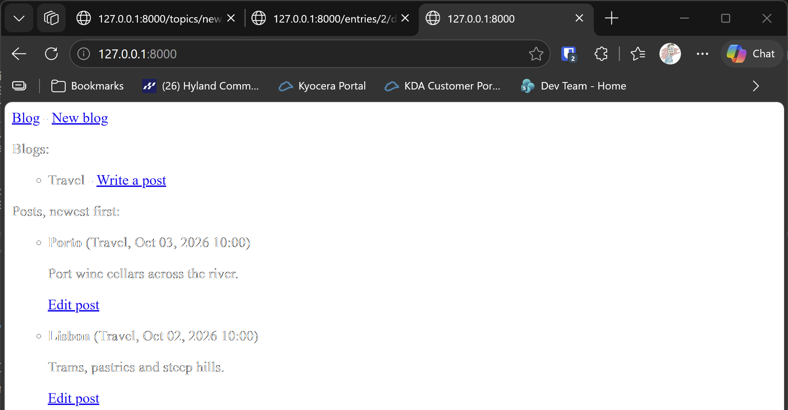

# Exercise 19-1: Blog

## The exercise

Start a new Django project called `Blog`. Create an app called `blogs`, with one model that represents an overall blog, and one model
that represents an individual blog post. Give each model an appropriate set of fields. Create a superuser for the project, and use the
admin site to make a blog and a couple of short posts. Make a home page that shows all posts in an appropriate order. Create pages for
making a blog, for making new posts, and for editing existing posts. Use your pages to make sure they work.

## Running this exercise

In the runner, open **Ch19 · User accounts**, then **Try it Yourself**, then **Exercise 19-1: Blog**, and click **Run**. The runner builds the
project, creates your admin account, loads two example posts in a blog called Travel, and opens the home page.

Or, from the chapter's virtual environment, in `try-it-yourself\19-1-blog`:

```pwsh
python manage.py migrate
python manage.py createsuperuser
python manage.py runserver
```

Then go to `http://127.0.0.1:8000/`.

## The code

The project has two models, one for the blog and one for its posts. Each post belongs to one blog:

```python
class Blog(models.Model):
    title = models.CharField(max_length=200)
    date_added = models.DateTimeField(auto_now_add=True)


class BlogPost(models.Model):
    blog = models.ForeignKey(Blog, on_delete=models.CASCADE)
    title = models.CharField(max_length=200)
    text = models.TextField()
    date_added = models.DateTimeField(auto_now_add=True)

    class Meta:
        ordering = ["-date_added", "-id"]
```

The `ordering` line sorts posts newest first, so the home page doesn't need to sort them itself. The `-id` part is a tie-breaker. Two posts saved in quick succession can share a timestamp, especially on Windows, and the id keeps their order stable.

The four addresses are in `blogs/urls.py`: the home page, the new blog page, the new post page for one blog, and the edit page for one post.

The views follow the same pattern as the Learning Log. `new_post` builds the post with `commit=False`, so it can set the blog before saving.

## Testing this exercise

The 12 tests in `blogs/tests.py` check the models, the home page order, and the new blog, new post and edit pages. Run them with
`python manage.py test`, and you should see `Ran 12 tests` and `OK`.

## Output

The home page, with the two example posts, newest first.



## Changed files

- `blog_project/`: the project settings, URLs, WSGI and ASGI files
- `blogs/`: the app, with its models, forms, views, templates, admin registration, migration and tests
- `manage.py`: the command-line tool

---
