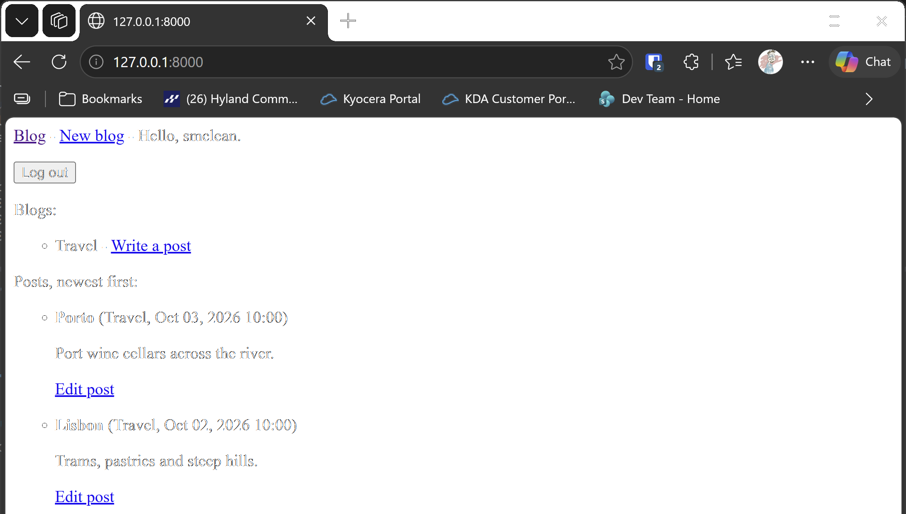

# Exercise 19-2: Blog Accounts

## The exercise

Add a user authentication and registration system to the Blog project you started in exercise 19-1. Make sure logged-in users see their
username somewhere on the screen, and unregistered users see a link to the registration page.

## Running this exercise

This exercise changes the Blog project from 19-1. The folder holds only the files that change, so the runner builds 19-1 first, then adds
these files on top.

In the runner, open **Ch19 · User accounts**, then **Try it Yourself**, then **Exercise 19-2: Blog Accounts**, and click **Run**. The
browser opens at the login page. Sign in with the account the runner made, or click **Register** to make another.

Or, from `try-it-yourself`, copy the 19-1 project to a new folder, and copy these files over it:

```pwsh
Copy-Item -Recurse 19-1-blog 19-2-blog
Copy-Item -Recurse -Force 19-2-blog-accounts\* 19-2-blog
cd 19-2-blog
python manage.py migrate
python manage.py runserver
```

## What changed

- `blog_project/settings.py` adds the accounts app, and sends visitors to the home page after signing in and out.
- `blog_project/urls.py` includes the accounts addresses under `accounts/`.
- `accounts/` is the new app. Its `urls.py` includes Django's built-in login and logout pages, and it adds a registration page. Its `views.py`
  uses Django's `UserCreationForm`, which checks the username and password and stores a hashed password.
- `blogs/templates/blogs/base.html` is the shared top bar. It shows **Hello, username** and a **Log out** button when someone is signed in,
  and **Log in** and **Register** links when no one is.

The key part of the top bar is the `user` check, which Django provides in every template:

```html

  Hello, {{ user.username }}.
  <form action="" method="post">
    
    <button name="submit">Log out</button>
  </form>

  <a href="">Log in</a> -
  <a href="">Register</a>

```

## Testing this exercise

The five tests in `accounts/tests.py` check that the login page loads, that registering creates the account and signs the new user in,
that logging out ends the session, and that the top bar shows the right links for a signed-in visitor and for one who isn't. The build
runs all 17 tests (the 12 from 19-1 and these 5), and you should see `Ran 17 tests` and `OK`.

## Output

The Blog top bar after signing in, showing the greeting and the Log out button.



## Changed files

- `blog_project/settings.py`: adds the accounts app and the redirects
- `blog_project/urls.py`: includes the accounts addresses
- `accounts/`: the new app, with its URLs, views, templates and tests
- `blogs/templates/blogs/base.html`: the sign-in state in the top bar
