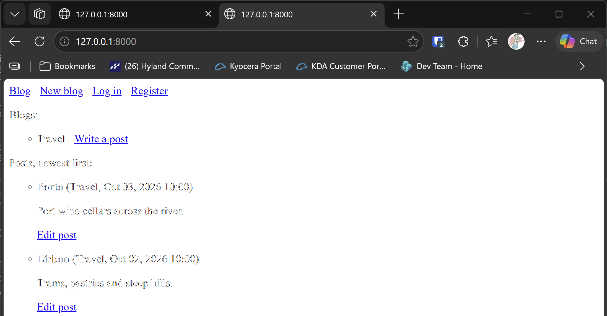

# Exercise 19-5: Protected Blog

## The exercise

In your Blog project, make sure each blog is connected to a particular user. Make sure all posts are publicly accessible but only registered
users can add posts and edit existing posts. In the view that allows users to edit their posts, make sure the user is editing their own post
before processing the form.

## Running this exercise

This exercise changes the Blog project from 19-2. The runner builds 19-1, then 19-2, then adds these files on top. The example Travel blog is
owned by the account the runner creates.

In the runner, open **Ch19 · User accounts**, then **Try it Yourself**, then **Exercise 19-5: Protected Blog**, and click **Run**. The browser
opens at the home page. It's public, so you can read the posts without signing in.

1. Read the two posts, Lisbon and Porto. You don't need to sign in to see them.
2. Click **Write a post** next to Travel. You're sent to the login page, because only registered users can write posts.
3. Sign in with the runner's account, then click **Write a post** again. Add a post, and check it appears on the home page.
4. Click **Log out**, then **Register**, and make a second account.
5. With the second account, try to edit one of the Travel posts. You should see a 404 page, because the second account doesn't own that blog.

Press **Escape** to stop the server when you're done.

## What changed

- `blogs/models.py` gives each `Blog` an owner, which is the user who made it.
- `blogs/migrations/0002_blog_owner.py` adds the owner field. A new database has no blogs, so the default of user 1 only matters for a database
  that already has data.
- `blogs/views.py` requires sign-in for the new blog, new post and edit pages. The new post and edit pages also check the owner of the blog
  before the form is read. The home page stays public.

The edit check is the one the book asks for. It runs first, so a user who isn't the owner gets a 404 page before the form is processed:

```python
@login_required
def edit_post(request, post_id):
    post = get_object_or_404(BlogPost, id=post_id)
    if post.blog.owner != request.user:
        raise Http404

    if request.method != "POST":
        form = BlogPostForm(instance=post)
    else:
        form = BlogPostForm(instance=post, data=request.POST)
        if form.is_valid():
            form.save()
            return redirect("blogs:index")
    --snip--
```

The book's wording is "make sure the user is editing their own post". A post doesn't have an owner of its own, so the check follows the post to its
blog: `post.blog.owner`. Adding a post uses the same rule. The new post page checks that the blog belongs to the signed-in user.

## Testing this exercise

The tests in `blogs/tests.py` check that the home page is public, that each new blog is saved under the signed-in user, that signed-out visitors
are sent to the login page, that another user gets a 404 page when they try to add a post or edit one, and the earlier model and page tests.
The build runs all 20 tests (15 for the blogs and 5 for the accounts), and you should see `Ran 20 tests` and `OK`.

## Output

The home page with the Travel posts, and the **Write a post** link beside the blog.



## Changed files

- `blogs/models.py`: adds the owner to `Blog`
- `blogs/migrations/0002_blog_owner.py`: adds the owner field
- `blogs/views.py`: requires sign-in for adding and editing, and checks the owner
- `blogs/tests.py`: gives every blog an owner, and adds the protection tests
- `seed.json`: the example blog, owned by user 1

---
