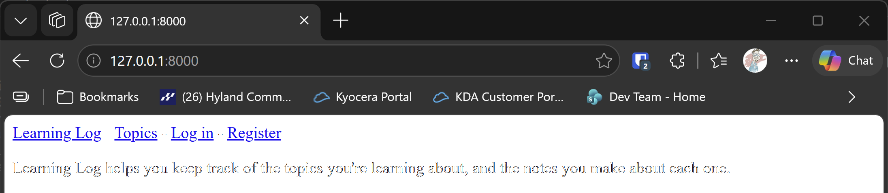

# Bootstrap Setup

## What this step does

Learning Log still looks plain. This chapter styles it with Bootstrap, a library of ready-made CSS (the stylesheet language) and components
such as navigation bars, buttons and forms. Bootstrap saves you from writing the styling yourself.

This step does the setup only. It installs `django-bootstrap5`, a Django package that loads Bootstrap into your templates, and adds it to
the project. The next steps use it to style each page.

## If you're using the lesson runner

In the steps list, open **Ch20 · Styling and deploying**, then **Bootstrap Setup**, and click **Run**. The runner installs nothing new, so you
need the requirements from the setup steps below in the chapter's virtual environment first. The browser opens at the home page, which still
looks plain. That's expected at this stage.

Press **Escape** to stop the server when you're done.

## For dummies: the quick version

1. In PowerShell, go to the `web-applications` folder, and make sure `(.venv)` is at the start of the line.
2. Install the requirements for this step, which adds the Bootstrap package:

   ```pwsh
   python -m pip install -r ch20-styling-and-deploying\lessons\01-bootstrap-setup\requirements.txt
   ```

3. Type `python build_stage.py ch20 1 --run` and press Enter. You should see `Ran 52 tests` and `OK`.
   If the build says the sample data belongs to an admin account, open a second PowerShell window in the `build` folder and run
   `python manage.py createsuperuser`, then `python manage.py loaddata seed.json`. The server keeps running while you do this.
4. Open `http://127.0.0.1:8000/`. The page looks the same as before.
5. Press Ctrl+C to stop the server.

### Words you'll see

- **CSS:** the language that sets colors, spacing and layout on a web page.
- **Bootstrap:** a CSS library with ready-made styles and components, which you add with class names such as `btn` and `navbar`.
- **CDN:** a server that delivers a library to any browser. Bootstrap is loaded from a CDN, so the browser downloads it straight from there.
- **Template tag:** a `` instruction in a template. `` makes the Bootstrap tags available.

## The code

`requirements.txt` pins the new package, next to Django:

```text
Django==5.2.17
django-bootstrap5==26.4
```

`ll_project/settings.py` adds the package to the installed apps:

```python
INSTALLED_APPS = [
    --snip--
    "django_bootstrap5",
    "learning_logs",
    "accounts",
]
```

The package is listed with the third-party apps, and the project's own apps come after it. The order matters only for templates that
override another app's templates, and Learning Log doesn't do that.

## Testing this step

The two tests in `ll_project/test_bootstrap.py` check that the package is listed in the installed apps, and that a template which loads its
tags renders without error. The build runs all 52 tests, which includes the 50 from chapter 19. You should see `Ran 52 tests` and `OK`.

## Output

The home page at `http://127.0.0.1:8000/`. It's still plain, because this step only installs Bootstrap.



## Changed files

- `requirements.txt`: adds `django-bootstrap5`
- `ll_project/settings.py`: adds `django_bootstrap5` to the installed apps
- `ll_project/test_bootstrap.py` (new): tests for the setup

---
