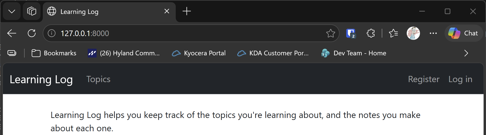

# Navigation Bar

## What this step does

Every page in Learning Log shares one template, `base.html`. This step rewrites that template so every page gets a Bootstrap navigation
bar at the top. The bar shows the Learning Log name, a Topics link, and on the right, the sign-in links or your name and a Log out button.

The page content sits in a container below the bar. Each page keeps its own content, because it fills in the `content` block of the shared
template, as it did before.

## If you're using the lesson runner

In the steps list, open **Ch20 · Styling and deploying**, then **Navigation Bar**, and click **Run**. The browser opens at the home page.

1. The dark bar across the top has **Learning Log** on the left, and **Register** and **Log in** on the right.
2. Click **Log in**, and sign in with the account from the runner.
3. The bar now shows **Hello**, your username, and a **Log out** button.

Press **Escape** to stop the server when you're done.

## For dummies: the quick version

1. In PowerShell, go to the `web-applications` folder, and make sure `(.venv)` is at the start of the line.
2. Type `python build_stage.py ch20 2 --run` and press Enter. You should see `Ran 55 tests` and `OK`.
3. The browser opens at the home page. Check the dark bar across the top.
4. Press Ctrl+C to stop the server.

### Words you'll see

- **Navigation bar:** the strip of links across the top of a page. Bootstrap's `navbar` class makes one.
- **Container:** a box that keeps the content to a comfortable width, centered on the page.
- **`block content`:** the named gap in the shared template. Each page fills it in.
- **`d-inline`:** a Bootstrap class that puts an element on the same line as its neighbors. It's used here so the Log out button sits in the bar.

## The code

The top of `base.html` loads the Bootstrap tags, and adds the stylesheet and the script:

```html

<head>
  
  
</head>
```

`` adds a link to the Bootstrap stylesheet, which the browser loads from a CDN, a server that delivers the library to any
browser. `` adds the script that opens the menu on small screens.

The navigation bar is a `nav` element with Bootstrap's classes:

```html
<nav class="navbar navbar-expand-md navbar-dark bg-dark mb-4 border-bottom">
  <div class="container-fluid">
    <a class="navbar-brand" href="">Learning Log</a>
    --snip--
  </div>
</nav>
```

- `navbar` styles the bar, and `navbar-expand-md` makes it collapse into a menu button on small screens.
- `navbar-dark bg-dark` gives it a dark background with light text.
- `navbar-brand` styles the Learning Log name.

The sign-in part of the bar uses the same `user.is_authenticated` check as before, so the only change is how it looks:

```html

  <span class="navbar-text me-2">Hello, {{ user.username }}.</span>
  <button name="submit" class="btn btn-outline-light btn-sm">Log out</button>

  <a class="nav-link" href="">Log in</a>

```

The page content goes inside `<main class="container">`, which keeps the content centered and to a sensible width.

## Testing this step

The three tests in `learning_logs/test_navbar.py` check that every page has the navigation bar, that it links to Topics, and that a
signed-in user sees their name and a Log out button. The build runs all 55 tests, and you should see `Ran 55 tests` and `OK`.

## Output

The home page with the navigation bar, and the page after signing in.



## Changed files

- `learning_logs/templates/learning_logs/base.html`: the new navigation bar, with the Bootstrap tags
- `learning_logs/test_navbar.py` (new): tests for the navigation bar
