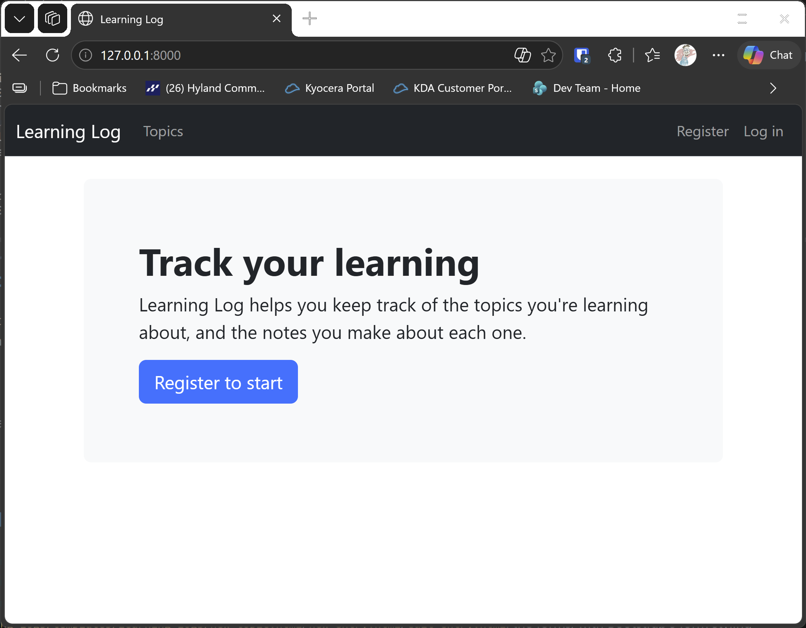
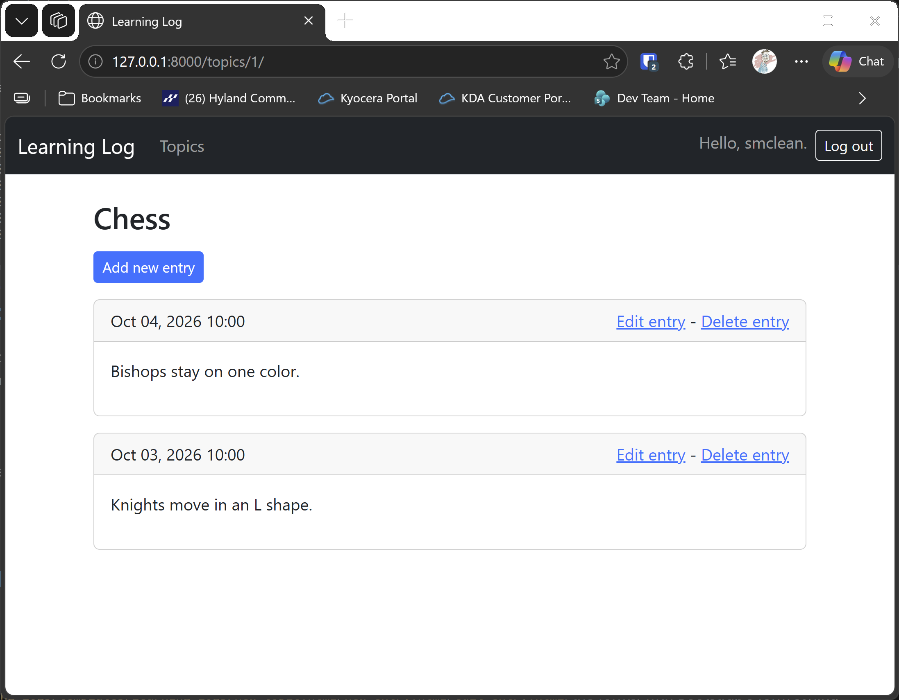

# Styled Pages

## What this step does

The navigation bar now matches the rest of the site. This step styles the pages themselves, using the same Bootstrap components:

- **Home page:** a large banner, with a button that leads to the topics page, or to the register page for a visitor who isn't signed in.
- **Log in and register pages:** the form fields are styled by Bootstrap, and the buttons use Bootstrap's primary style.
- **Topics page:** the topics are a list group, where each row is a link.
- **Topic page:** each entry is a card. The date is in a header, with the Edit and Delete links beside it.
- **Forms for topics and entries:** the new topic, new entry and edit pages use the same form styling as the log in page.

The content and links on every page are the same as before. Only the presentation changes.

## If you're using the lesson runner

In the steps list, open **Ch20 · Styling and deploying**, then **Styled Pages**, and click **Run**. The browser opens at the home page.

1. The home page shows a large banner, with **Track your learning** and a button.
2. Sign in with the account from the runner, then click **View your topics**. The topics appear as a list of rows.
3. Click **Chess**. Each entry is a card, with its date in a grey header.

Press **Escape** to stop the server when you're done.

## For dummies: the quick version

1. In PowerShell, go to the `web-applications` folder, and make sure `(.venv)` is at the start of the line.
2. Type `python build_stage.py ch20 3 --run` and press Enter. You should see `Ran 59 tests` and `OK`.
3. Check the home page, then the topics page, and then a topic page, as described in the runner steps above.
4. Press Ctrl+C to stop the server.

### Words you'll see

- **Banner:** a large, shaded block at the top of a page. Bootstrap's `p-5 mb-4 bg-light rounded-3` classes give it padding, space below, a light background and rounded corners.
- **List group:** a set of rows that look like a list. Adding `list-group-item-action` makes each row clickable.
- **Card:** a bordered box with an optional header and body. Each entry is one card.
- **`bootstrap_form`:** a template tag from `django_bootstrap5`. It draws every field of a form in Bootstrap's style, including the error messages.

## The code

The home page banner uses plain Bootstrap classes, with no Python at all:

```html
<div class="p-5 mb-4 bg-light rounded-3">
  <div class="container-fluid py-3">
    <h1 class="display-5 fw-bold">Track your learning</h1>
    <p class="fs-5">Learning Log helps you keep track of the topics you're learning about, and the notes you make about each one.</p>
  </div>
</div>
```

The topics page turns each topic into a row of a list group:

```html
<div class="list-group">
  
    <a class="list-group-item list-group-item-action" href="">{{ topic.text }}</a>
  
    <div class="list-group-item">No topics have been added yet.</div>
  
</div>
```

The topic page shows each entry as a card. The `` loop and `` part are the same as in chapter 18:

```html

  <div class="card mb-3">
    <div class="card-header d-flex justify-content-between">
      <span>{{ entry.date_added|date:"M d, Y H:i" }}</span>
      <span>
        <a href="">Edit entry</a> -
        <a href="">Delete entry</a>
      </span>
    </div>
    <div class="card-body">
      {{ entry.text|linebreaks }}
    </div>
  </div>

```

The form pages load the Bootstrap tags, then draw the whole form with one tag. The form's errors, such as the duplicate topic message, appear in the same style:

```html


<form method="post" action="">
  
  
  
</form>
```

## Testing this step

The four tests in `learning_logs/test_styling.py` check that the home page has the banner, the topics page uses a list group, a topic's entries
are cards, and the log in button uses the primary style. The build runs all 59 tests, and you should see `Ran 59 tests` and `OK`.

## Output

The home page with its banner, and a topic page with its entries as cards.





## Changed files

- `learning_logs/templates/learning_logs/index.html`: the home page banner
- `learning_logs/templates/learning_logs/topics.html`: the topics list group
- `learning_logs/templates/learning_logs/topic.html`: the entries as cards
- `learning_logs/templates/learning_logs/new_topic.html`, `new_entry.html`, `edit_entry.html`: the forms, with Bootstrap's form styling
- `accounts/templates/registration/login.html`, `register.html`: the sign-in and registration forms
- `learning_logs/test_styling.py` (new): tests for the styling
