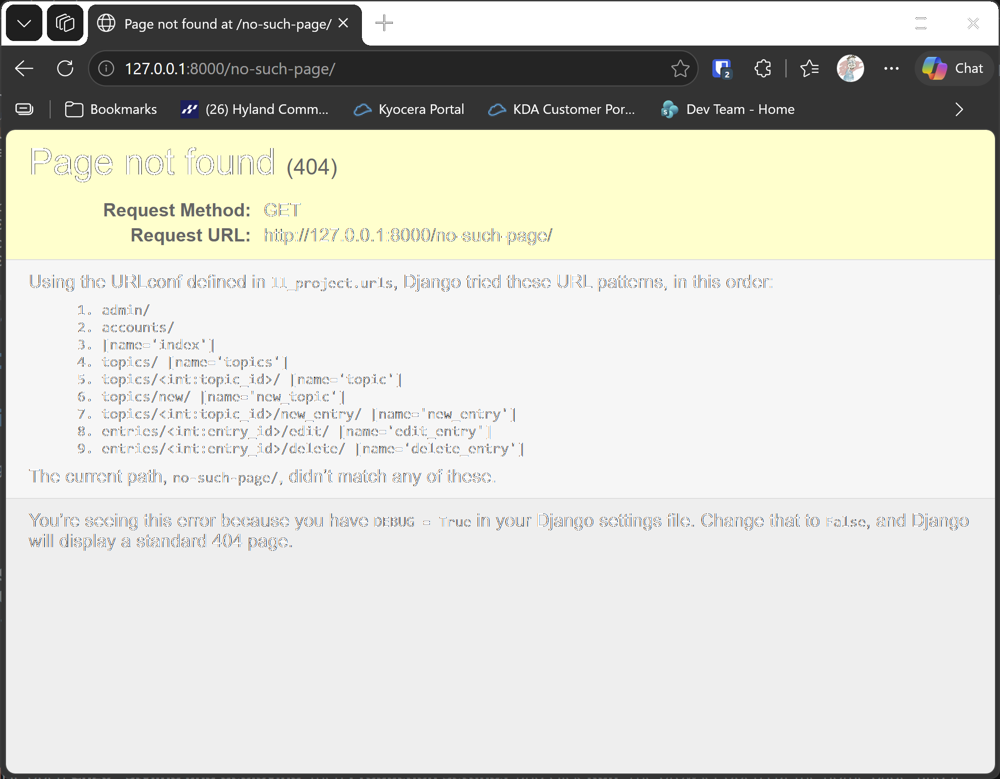

# Production Settings

## What this step does

Learning Log runs on your own computer with debug mode on. Debug mode shows detailed error pages, which is helpful when you're building, but
it would show too much to visitors of a live site. This step prepares the project for the live site, without changing how it runs locally.

Three things change:

- **Settings come from the environment.** The secret key, debug mode and allowed addresses are read from environment variables. The live site
  sets them; your computer doesn't need to.
- **Static files have a home.** `STATIC_ROOT` is the folder that `collectstatic` fills with the Bootstrap and admin files, so the live server
  can serve them.
- **Errors show a friendly page.** An address that doesn't exist shows a Learning Log page, not Django's technical page.

## If you're using the lesson runner

In the steps list, open **Ch20 · Styling and deploying**, then **Production Settings**, and click **Run**. The browser opens at the home page,
and it works exactly as before, because the defaults are the same as the local settings.

1. Go to `http://127.0.0.1:8000/no-such-page/`. You should see Django's debug page, titled **Page not found (404)**, with a list of the URL patterns it tried. That's expected locally, because debug mode is on. The friendly page is what visitors see on the live site.
2. Go back to `http://127.0.0.1:8000/` to return to the home page.

Press **Escape** to stop the server when you're done.

## For dummies: the quick version

1. In PowerShell, go to the `web-applications` folder, and make sure `(.venv)` is at the start of the line.
2. Type `python build_stage.py ch20 4 --run` and press Enter. You should see `Ran 62 tests` and `OK`.
3. Go to `http://127.0.0.1:8000/no-such-page/` and check the debug page, titled Page not found (404).
4. Press Ctrl+C to stop the server.

### Words you'll see

- **Environment variable:** a named value set outside the code. The live site sets `LL_SECRET_KEY`, and the code reads it with `os.environ`.
- **`DEBUG`:** when it's on, Django shows detailed error pages. It must be off on the live site.
- **`ALLOWED_HOSTS`:** the addresses the site will answer to. Requests for any other address are refused.
- **`collectstatic`:** a command that copies every static file into `STATIC_ROOT`, so a live server can serve them.

## The code

The secret key and debug mode are read from the environment, with the local values as defaults:

```python
SECRET_KEY = os.environ.get("LL_SECRET_KEY", "django-insecure-learning-log-training-key-change-before-deploying")
DEBUG = os.environ.get("LL_DEBUG", "1") == "1"
```

`os.environ.get` returns the value of the variable, or the default when it isn't set. Locally nothing is set, so the defaults apply, and the
site works as before. On the live site, `LL_DEBUG` is set to `0`, which makes `DEBUG` false.

The allowed addresses always include this computer, and add any extra addresses from `LL_ALLOWED_HOSTS`:

```python
ALLOWED_HOSTS = ["127.0.0.1", "localhost"] + [
    host.strip() for host in os.environ.get("LL_ALLOWED_HOSTS", "").split(",") if host.strip()
]
```

`STATIC_ROOT` sets where `collectstatic` puts the static files:

```python
STATIC_ROOT = BASE_DIR / "staticfiles"
```

The debug page, titled Page not found (404), is what you see on your own computer while debug mode is on. It lists the URL patterns Django
tried, which helps while you're building. Django only shows the friendly page when debug mode is off, which is how visitors see the live site. The
local site stays in debug mode, so students always see the detailed pages while they learn.

The friendly page is `learning_logs/templates/404.html`. Django uses this name automatically when a page isn't found and debug mode is off. It
extends the shared layout, so the top bar stays on the page:

```html

```

The 500 page is standalone. It doesn't extend the shared layout, because a server error can happen before the request has finished, and the
shared layout relies on the request. It loads only the Bootstrap stylesheet.

## Checking the live settings

Before the live deployment, Django can check the settings for common problems. Run this with the live settings set, from the build folder:

```pwsh
$env:LL_DEBUG = "0"
$env:LL_SECRET_KEY = "a-long-random-value-you-make-up"
python manage.py check --deploy
```

The check reports any setting that's unsafe for the live site. With `LL_DEBUG` set to `0`, the debug warning goes away. Any warnings about HTTPS and
cookies are covered in the deployment lesson, which checks them against the live address.

## Testing this step

The three tests in `learning_logs/test_errors.py` check that an unknown address uses the custom 404 page, that the page has its friendly message,
and that `STATIC_ROOT` is set. The build runs all 62 tests, and you should see `Ran 62 tests` and `OK`.

## Output

The debug page for an address that doesn't exist, as you see it locally, with the list of URL patterns Django tried. The friendly page appears on the
live site, in the deployment step.



## Changed files

- `ll_project/settings.py`: reads the key, debug mode and allowed addresses from the environment, and sets `STATIC_ROOT`
- `learning_logs/templates/404.html` (new): the friendly 404 page
- `learning_logs/templates/500.html` (new): the standalone error page
- `learning_logs/test_errors.py` (new): tests for the error page and settings

---
