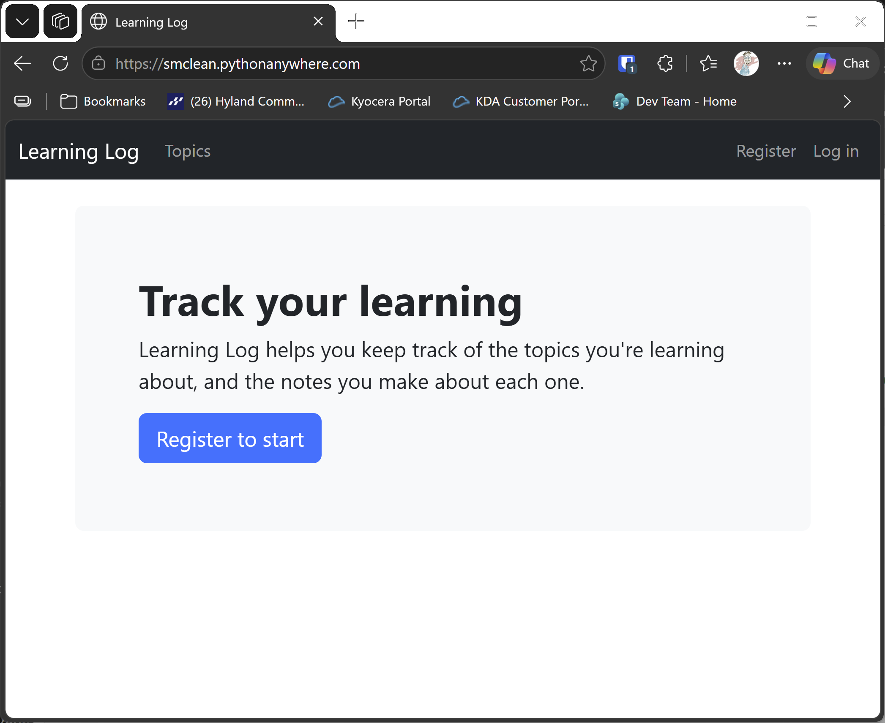
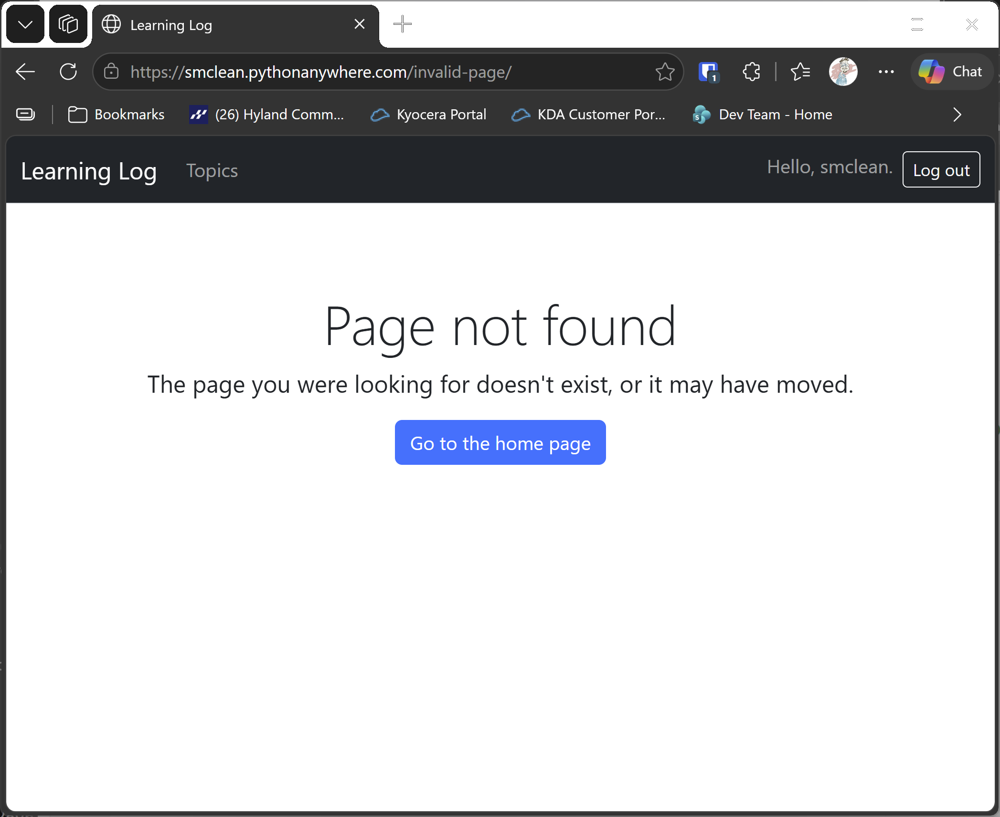

# Deploying to PythonAnywhere

## What this step does

Until now, Learning Log has run only on your own computer. This step puts it on the internet, on your own free PythonAnywhere site, at an
address like `https://yourname.pythonanywhere.com`. Anyone with the address can visit it, so this is the first step where the site is live.

You'll do the steps yourself, in a web browser and a PythonAnywhere console. The lesson runner doesn't deploy the site, because the site has to
live on PythonAnywhere.

## Why PythonAnywhere, and how this differs from the book

The book deploys to Platform.sh, which has since been renamed Upsun. Upsun's only free option is a 15-day trial, and this course needs a free
deployment that lasts for the whole course, so we use PythonAnywhere instead. The reasons:

- **A free tier that keeps your data.** The free account keeps its files, including the SQLite database, on disk. Render's free database would
  expire partway through a course, and Upsun's free trial ends after 15 days.
- **No card and no budget needed.** Students can open the account themselves, and there's no hosting bill.
- **Students deploy their own site.** Each student creates a free account and uploads their own project, so no instructor needs to be involved.
- **Not AWS.** Students don't have access to deploy to AWS. That goes through the cloud team and a security review, which this example wouldn't pass.

The main differences from the book's Platform.sh steps:

- **Upload, not Git.** The book pushes the project to Git and Platform.sh pulls it. Here you upload a zip file through the PythonAnywhere Files tab.
- **No Platform.sh configuration files.** The book's `.platform.app.yaml`, `routes.yaml`, `services.yaml` and `platformshconfig` aren't needed. PythonAnywhere
  runs the site from its Web tab and a WSGI file.
- **SQLite, not Postgres.** The book's Platform.sh database is Postgres. Here the database is the SQLite file, which PythonAnywhere keeps on disk.
- **Settings come from environment variables.** The book reads the secret key from Platform.sh. Here you set `LL_SECRET_KEY`, `LL_DEBUG` and
  `LL_ALLOWED_HOSTS` in the WSGI file, which you edit on PythonAnywhere.
- **Django 5.2.17, not 4.1.** The book pins Django 4.1, and this course uses the current long-term support release.

## Before you start

You'll upload the finished project from the build folder. Build the step first, so you know the project works locally:

```pwsh
python build_stage.py ch20 5 --run
```

You should see `Ran 62 tests` and `OK`. Press Ctrl+C to stop the server.

Then create a zip file of the **contents** of `build\ch20-styling-and-deploying-step-05`, not the folder itself. Leave out `db.sqlite3`. It holds your local
accounts and topics, and PythonAnywhere creates its own database. Also leave out `seed.json`, which is sample data for the local build, any `.venv` folder, and the `__pycache__` folders.

Name the zip `learning_log.zip`.

## Deploying, step by step

Check each step against the PythonAnywhere Web tab before you go on. PythonAnywhere sometimes changes the wording of its buttons, so the labels
below may differ slightly.

1. **Create your account.** Go to `pythonanywhere.com`, and choose the free **Beginner** account. You'll need to accept the terms yourself, and
   choose your own username. After you confirm your email address, PythonAnywhere takes you to your account page, at
   `https://www.pythonanywhere.com/user/yourusername/`. That page is your account, not your site. Your site doesn't exist yet, and its address,
   `https://yourusername.pythonanywhere.com`, only starts working after you create the web app in step 7.
2. **Upload the zip.** Open the **Files** tab, and go to `/home/yourusername`. Click **Upload a file**, and choose `learning_log.zip`.
3. **Make the project folder.** Open a **Bash console** from the Consoles tab, and run:

   ```bash
   mkdir learning_log
   unzip learning_log.zip -d learning_log
   ```

   Check the folder with `ls learning_log`. You should see `manage.py`, `requirements.txt`, `ll_project`, `learning_logs` and `accounts`.
4. **Make a virtual environment and install the packages.** Choose the newest Python version the console offers, then run:

   ```bash
   mkvirtualenv --python=python3.12 ll-env
   pip install -r ~/learning_log/requirements.txt
   ```

   If Python 3.12 isn't offered, use the newest version listed, and it must be at least 3.10.
5. **Make a secret key.** In the same console, run this, and copy the result. Keep it private, because anyone who has it can sign in to your site:

   ```bash
   python -c "import secrets; print(secrets.token_urlsafe(50))"
   ```

6. **Create the database and an admin account.** Activate the virtual environment first, so the commands use the packages you installed. Your
   prompt should then start with `(ll-env)`. If it doesn't, the next commands will fail, with an error about a missing module such as
   `django_bootstrap5`. Run:

   ```bash
   workon ll-env
   cd ~/learning_log
   python manage.py migrate
   python manage.py createsuperuser
   python manage.py collectstatic
   ```

   `collectstatic` copies the Bootstrap and admin files into a `staticfiles` folder, where the web server can find them.
7. **Create the web app.** Open the **Web** tab, and choose **Add a new web app**. The first screen asks for your web app's domain name. On a free
   account there's no choice to make: your site will be at `yourusername.pythonanywhere.com`, so click **Next**. On the next screen, choose
   **Manual configuration**, then the same Python version you used in step 4. If that option isn't offered, tell the course author what the screen
   shows, because the steps below depend on it.
8. **Set the virtualenv.** On the Web tab, in the Virtualenv section, enter the path `/home/yourusername/.virtualenvs/ll-env`.
9. **Edit the WSGI file.** On the Web tab, click the link to the WSGI configuration file, delete its contents, and replace them with this. Put
   your own username and the secret key from step 5 in place of the placeholders:

   ```python
   import os
   import sys

   path = "/home/yourusername/learning_log"
   if path not in sys.path:
       sys.path.insert(0, path)

   os.environ["DJANGO_SETTINGS_MODULE"] = "ll_project.settings"
   os.environ["LL_SECRET_KEY"] = "paste-your-secret-key-here"
   os.environ["LL_DEBUG"] = "0"
   os.environ["LL_ALLOWED_HOSTS"] = "yourusername.pythonanywhere.com"

   from django.core.wsgi import get_wsgi_application
   application = get_wsgi_application()
   ```

   This file lives on PythonAnywhere, not in your zip, so the secret key is never stored with the project's code.
10. **Map the static files.** On the Web tab, in the Static files section, add:
    - **URL:** `/static/`
    - **Directory:** `/home/yourusername/learning_log/staticfiles`

    Without this, the page shows without Bootstrap styling, and the admin site has no styles.
11. **Reload the site.** Click the green **Reload** button at the top of the Web tab, and wait for it to finish.
12. **Visit your site.** Open `https://yourusername.pythonanywhere.com`. You should see the banner. Then try the checks below.

## Checking the live site

- The home page shows the banner, with the navigation bar above it, and the styling is in place.
- Go to `https://yourusername.pythonanywhere.com/no-such-page/`. You should see the friendly **Page not found** page, with its button to the home page.
- Go to `https://yourusername.pythonanywhere.com/admin/`, and sign in with the account you created in step 6.
- Register a new account from the top bar, and check that you can add a topic.

## Keeping the site running

A free PythonAnywhere web app expires after a month. The Web tab shows when it expires, and has an option to extend it. Renew it each month for as long
as the course runs. Your files and database stay in place while the site is expired, but the site won't answer until you renew it.

If you change the project, zip the new build again, upload it, unzip it over the old folder, then reload the site. Your database is kept, so your
topics and accounts stay.

## Troubleshooting

- **A "Something went wrong" page:** the friendly 500 page appeared. Open the **Error log** link on the Web tab. The last lines explain the problem.
- **The page shows without styling, or the admin site looks plain:** the static files mapping is missing or wrong. Check step 10, and run `collectstatic`
  again in the console.
- **"Invalid HTTP_HOST header":** the address you're visiting isn't in `LL_ALLOWED_HOSTS`. Check the WSGI file, then reload.
- **"No module named" errors, such as `django_bootstrap5`:** the virtual environment isn't active in this console. Run `workon ll-env`, and check
  that the prompt starts with `(ll-env)`. Every new console needs this.
- **Changes don't appear:** you need to reload the site after each change, and after editing the WSGI file.

## Testing this step

This step doesn't add new code, so there are no new tests. The build check (`Ran 62 tests` and `OK`) confirms the project before you upload it, and
the checks above confirm the live site.

## Output

The live home page, and the friendly 404 page on the live site.





## Changed files

- `requirements.txt`: the packages the live site installs, which go into the upload with the project

---
