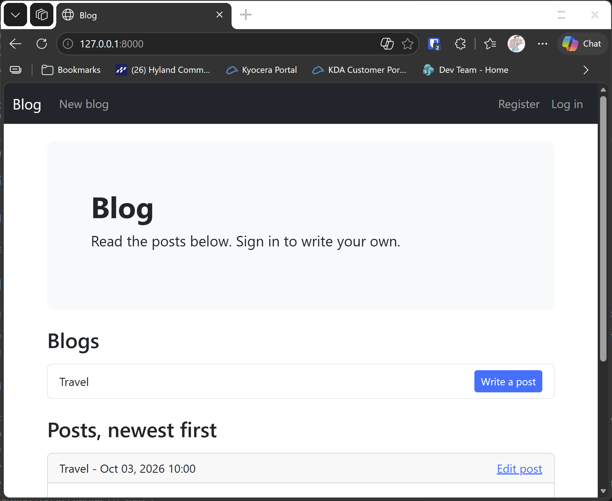

# Exercise 20-2: Stylish Blog

## The exercise

Use Bootstrap to style the Blog project you created in Chapter 19.

## Running this exercise

This exercise changes the Blog project from exercise 19-5. The runner builds 19-1, then 19-2, then 19-5, then adds the templates in this folder.

In the runner, open **Ch20 · Styling and deploying**, then **Try it Yourself**, then **Exercise 20-2: Stylish Blog**, and click **Run**. The browser
opens at the home page. Sign in with the runner's account, or register a new one.

## What changed

- `blog_project/settings.py` adds the Bootstrap package, `django_bootstrap5`, to the installed apps. The package must be installed first, which the
  requirements from chapter 20, step 1 do. If you've already done that for the Learning Log, you don't need to do it again.
- `blogs/templates/blogs/base.html` gives the Blog a Bootstrap navigation bar, with the same sign-in state as before.
- `blogs/templates/blogs/index.html` shows the blogs as a list group, and each post as a card.
- `blogs/templates/blogs/new_blog.html`, `new_post.html` and `edit_post.html` use `bootstrap_form` and `bootstrap_button`, the same approach as the
  Learning Log in chapter 20, step 3.
- `accounts/templates/registration/login.html` and `register.html` use the same Bootstrap styling, and extend the Blog's base page.

The home page's post cards use Bootstrap's card classes:

```html
<div class="card mb-3">
  <div class="card-header d-flex justify-content-between">
    <span>{{ post.blog.title }} - {{ post.date_added|date:"M d, Y H:i" }}</span>
    <a href="">Edit post</a>
  </div>
  <div class="card-body">
    <h5 class="card-title">{{ post.title }}</h5>
    {{ post.text|linebreaks }}
  </div>
</div>
```

## Testing this exercise

The three tests in `blogs/test_styling.py` check that the navigation bar appears, that the home page shows posts as cards, and that the new blog form
uses Bootstrap's button style. The build runs all 23 tests (the 20 from exercise 19-5, and these 3), and you should see `Ran 23 tests` and `OK`.

## Output

The Blog home page, styled with the navigation bar, the blog list, and the post cards.



## Changed files

- `blogs/templates/blogs/base.html`, `index.html`, `new_blog.html`, `new_post.html`, `edit_post.html`: the Bootstrap styles
- `accounts/templates/registration/login.html`, `register.html`: the Bootstrap styles
- `blogs/test_styling.py` (new): tests for the styling

---
