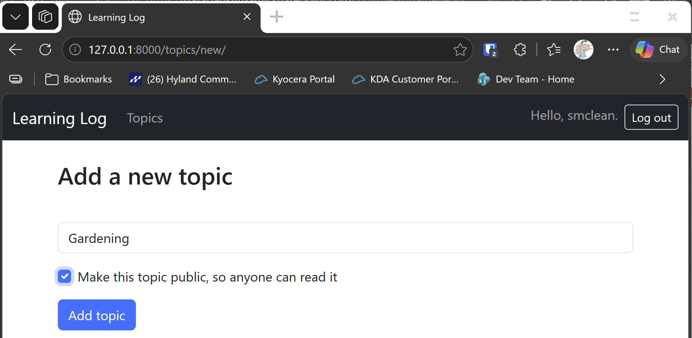
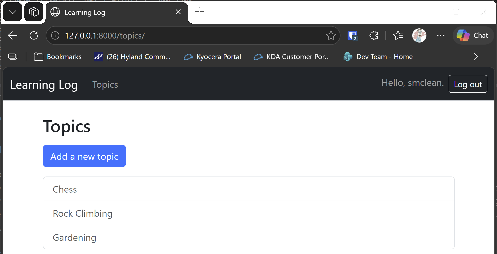
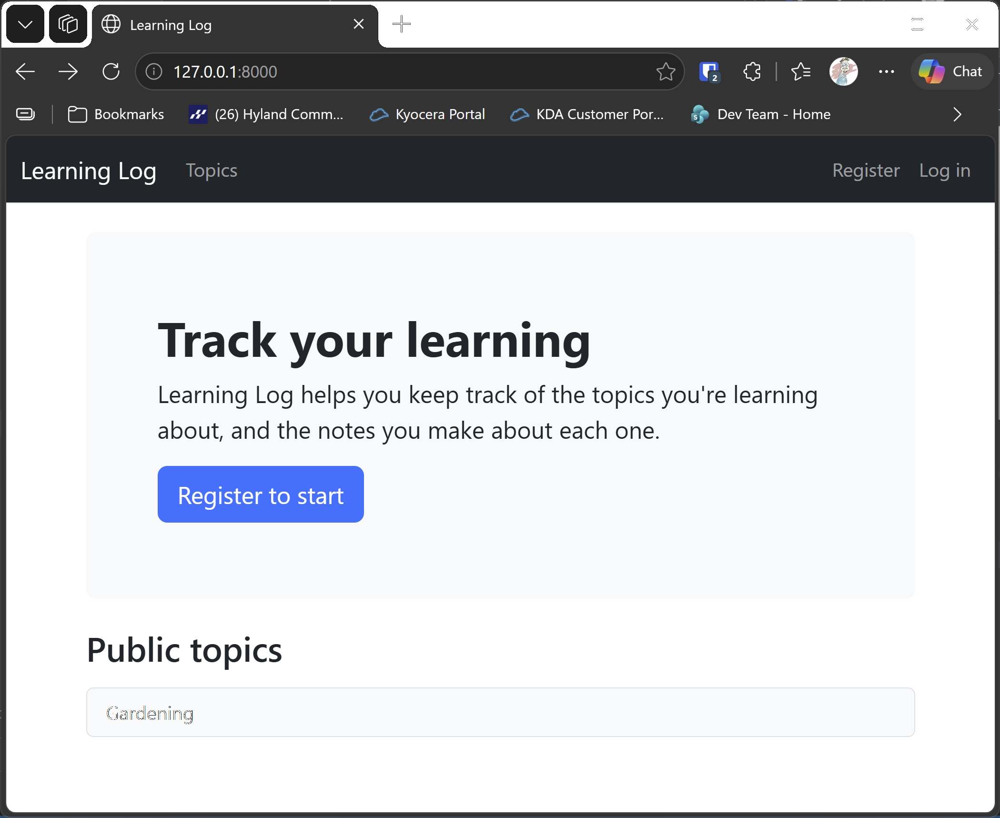

# Exercise 20-4: Extended Learning Log

## The exercise

Add one feature to Learning Log, and push the change to your live deployment. Try a simple change, such as writing more about the project on the
home page. Then try adding a more advanced feature, such as giving users the option of making a topic public. This would require an attribute
called `public` as part of the Topic model (this should be set to `False` by default) and a form element on the new_topic page that allows the user
to change a topic from private to public. You'd then need to migrate the project and revise `views.py` so any topic that's public is visible to
unauthenticated users as well.

## Deploying the change is optional

As in exercise 20-3, pushing the change to a live site is optional. The exercise is to add the feature, and the tests show that it works. If you
have a live site, the steps are in chapter 20, step 5: upload the new build, migrate, and reload.

## Running this exercise

This exercise builds on the Learning Log from chapter 20, step 5, and adds the public topics feature. In the runner, open **Ch20 · Styling and
deploying**, then **Try it Yourself**, then **Exercise 20-4: Extended Learning Log**, and click **Run**. The browser opens at the home page, which now
shows a Public topics list, empty until a topic is made public.

1. Sign in with the runner's account, then open **Add a new topic**. Type a name, tick **Make this topic public**, and click **Add topic**.
2. Sign out. On the home page, your topic should appear under **Public topics**, and you can open it without signing in.
3. Try a private topic, and open it while signed out. You should be sent to the login page.

## What changed

- **The model.** `Topic` gets a `public` field, a `BooleanField` that's `False` by default, so every new topic is private until its owner changes it.
  The migration `0005_topic_public` adds the field.
- **The form.** The new topic form includes the `public` checkbox, so the owner chooses when the topic is created.
- **The views.** `topic` no longer requires sign-in on its own. A public topic is open to everyone. For a private topic, a visitor who isn't signed in is
  sent to the login page, and a signed-in user who doesn't own it gets a 404 page. The home page passes the public topics to its template.
- **The templates.** The topic page shows the add, edit and delete links only to the owner, through `is_owner`. The home page lists the public topics.

The key part of the topic view is the check that decides who can see a topic:

```python
def topic(request, topic_id):
    topic = get_object_or_404(Topic, id=topic_id)
    is_owner = request.user.is_authenticated and topic.owner == request.user

    if not topic.public and not is_owner:
        if not request.user.is_authenticated:
            return redirect_to_login(request.get_full_path())
        raise Http404
    --snip--
```

A public topic skips the check. Everything that changes a topic, such as adding, editing or deleting entries, still checks the owner, so making a topic
public doesn't let anyone else change it.

## Testing this exercise

The six tests in `learning_logs/test_public.py` check that new topics are private by default, that a visitor who isn't signed in can read a public topic,
that a private one sends them to sign in, that the home page lists public topics, that other users don't see the owner's links, and that the Public box
saves the setting. The build runs all 68 tests, and you should see `Ran 68 tests` and `OK`.

## Output

Creating a public topic: the new topic form with **Make this topic public** ticked.



Viewing your own topics: both topics, with the public one marked.



Viewing public topics: a visitor who isn't signed in opens the public topic from the home page.



## Changed files

- `learning_logs/models.py`: adds the `public` field to `Topic`
- `learning_logs/migrations/0005_topic_public.py`: adds the field to the database
- `learning_logs/forms.py`: adds the Public checkbox to the topic form
- `learning_logs/views.py`: lets anyone read a public topic, and lists public topics on the home page
- `learning_logs/templates/learning_logs/topic.html`: shows the owner's links only to the owner, and a Public badge
- `learning_logs/templates/learning_logs/index.html`: lists the public topics
- `learning_logs/test_public.py` (new): tests for public topics
