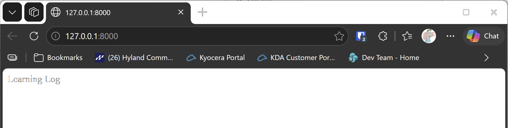

# Flask Setup

## What this step does

This step builds the Learning Log with Flask instead of Django. Flask is a smaller framework: the app is a set of Python functions, each tied
to an address, and Flask does the rest. There's no project folder layout to learn first, and no separate admin site.

The step sets up three things:

- **The app.** `flask_log/__init__.py` has `create_app`, which builds the app. `flask_app.py` calls it, so Flask has an app to run.
- **The database.** SQLAlchemy keeps its connection string in `DATABASE_URL`. Locally it's a SQLite file, `learning_log.db`. Later, a SQL Server
  or MySQL connection string can replace it, without changing the code.
- **The commands.** `flask init-db` creates the tables, `flask create-admin` creates the admin account, and `flask load-seed` loads example data.
  The build runs all three, so every step is set up the same way. The last two are placeholders until the steps that need them.

## Before you start

This chapter uses the same virtual environment as the Django chapters, in `web-applications\.venv`. Flask and SQLAlchemy need to be installed in
it. From the `web-applications` folder, run:

```pwsh
.venv\Scripts\python.exe -m pip install -r ..\..\part-iii-beyond-the-book\s25-flask-learning-log\01-flask-setup\requirements.txt
```

If the runner reports that the environment isn't ready, it shows this command in the output, so you can copy it from there.

## If you're using the lesson runner

In the steps list, open **Part III · Beyond the Book**, then **S25 · Flask learning log**, then **Flask Setup**, and click **Run**. The runner
builds the step, runs the tests, and starts the server. The browser opens at the home page.

Press **Escape** to stop the server when you're done.

## For dummies: the quick version

1. In PowerShell, go to the `web-applications` folder, and install the requirements above, if you haven't already.
2. Type `python build_stage.py s25 1 --run` and press Enter. You should see `Ran 3 tests` and `OK`.
3. Open `http://127.0.0.1:8000/`. The page shows Learning Log.
4. Press Ctrl+C to stop the server.

### Words you'll see

- **Flask:** a small web framework. Each address is a Python function, marked with `@app.route`.
- **Application factory:** `create_app`, a function that builds the app. Tests use it to build an app with a different database.
- **SQLAlchemy:** a library that maps Python classes to database tables. Its connection string says which database to use.
- **Connection string:** the address of a database, such as `sqlite:///learning_log.db`. A SQL Server or MySQL string names the server, the database and
  the login.

## The code

`flask_log/__init__.py` builds the app, and connects it to the database:

```python
def create_app(config: dict | None = None) -> Flask:
    app = Flask(__name__)
    app.config["DATABASE_URL"] = os.environ.get("DATABASE_URL", DEFAULT_DATABASE_URL)
    if config:
        app.config.update(config)

    engine = make_engine(app.config["DATABASE_URL"])
    app.extensions["engine"] = engine
    app.extensions["session_factory"] = make_session_factory(engine)
    ...
```

`os.environ.get` reads `DATABASE_URL` if it's set, and uses the SQLite file if it isn't. The tests pass their own config, so they never touch your
database.

The home page is the first route:

```python
@app.route("/")
def index() -> str:
    return "Learning Log"
```

`flask_app.py` is the file Flask runs. It's one line of setup:

```python
from flask_log import create_app

app = create_app()
```

`flask_log/database.py` holds the SQLAlchemy pieces: `Base`, which every table class inherits from, and the functions that make the engine and the
session factory.

## Testing this step

The three tests in `tests/test_setup.py` check that the home page answers, that it shows the app's name, and that the database connection is made.
The build runs them with unittest, the test library that comes with Python. You should see `Ran 3 tests` and `OK`.

## Output

The home page at `http://127.0.0.1:8000/`, showing Learning Log as plain text. Templates and styling come in the next step.



## Changed files

- `flask_app.py`: the entry point Flask runs
- `flask_log/__init__.py`: the app factory, the home page, and the three commands
- `flask_log/database.py`: the SQLAlchemy base class, the engine and the session factory
- `tests/test_setup.py`: tests for the setup
- `requirements.txt`: Flask and SQLAlchemy
