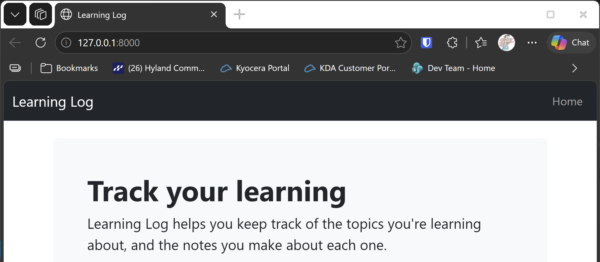

# Templates and Layout

## What this step does

The home page is no longer plain text. This step adds a shared layout, a Jinja template called `base.html`, and the home page now extends it. Every
page in the site gets the same top bar, and the same Bootstrap styling, without repeating the HTML.

A Jinja template is an HTML file with placeholders. `` is a gap that each page fills in. `{{ url_for('index') }}` builds the
address of a page from the name of its route, so links keep working if an address changes.

## If you're using the lesson runner

In the steps list, open **Part III · Beyond the Book**, then **S25 · Flask learning log**, then **Templates and Layout**, and click **Run**. The
browser opens at the home page.

1. The page has a dark navigation bar at the top, with Learning Log on the left.
2. Below it is a banner with the words Track your learning.

Press **Escape** to stop the server when you're done.

## For dummies: the quick version

1. In PowerShell, go to the `web-applications` folder.
2. Type `python build_stage.py s25 2 --run` and press Enter. You should see `Ran 5 tests` and `OK`.
3. Check the home page for the navigation bar and the banner.
4. Press Ctrl+C to stop the server.

### Words you'll see

- **Template:** an HTML file with placeholders that Flask fills in. Flask reads templates from the `templates` folder inside the package.
- **Block:** a named gap in a template, such as `content`. A page that extends the template fills the gap.
- **`url_for`:** builds the address of a route from its function name. `url_for('index')` is the home page's address.
- **Bootstrap:** a CSS library. This step loads it from a CDN, a server that delivers the library to any browser.

## The code

`flask_log/templates/base.html` is the shared layout. It holds the page's head, the navigation bar, and the `content` block:

```html
<nav class="navbar navbar-expand-md navbar-dark bg-dark mb-4 border-bottom">
  <div class="container-fluid">
    <a class="navbar-brand" href="{{ url_for('index') }}">Learning Log</a>
    --snip--
  </div>
</nav>

<main class="container">
  
</main>
```

`flask_log/templates/index.html` extends the layout, and fills the content block:

```html



  <div class="p-5 mb-4 bg-light rounded-3">
    <h1 class="display-5 fw-bold">Track your learning</h1>
    --snip--
  </div>

```

The route calls `render_template`, which finds the template and fills it in:

```python
@app.route("/")
def index() -> str:
    return render_template("index.html")
```

Before this step the route returned the words Learning Log. Now it returns a page built from two templates.

## Testing this step

The two tests in `tests/test_layout.py` check that the home page has the navigation bar, and the banner. The build runs all five tests, the three from
step 1 and these two. You should see `Ran 5 tests` and `OK`.

## Output

The home page with the navigation bar and the banner.



## Changed files

- `flask_log/templates/base.html` (new): the shared layout
- `flask_log/templates/index.html` (new): the home page, which extends the layout
- `flask_log/__init__.py`: the home page route renders its template
- `tests/test_layout.py` (new): tests for the layout
