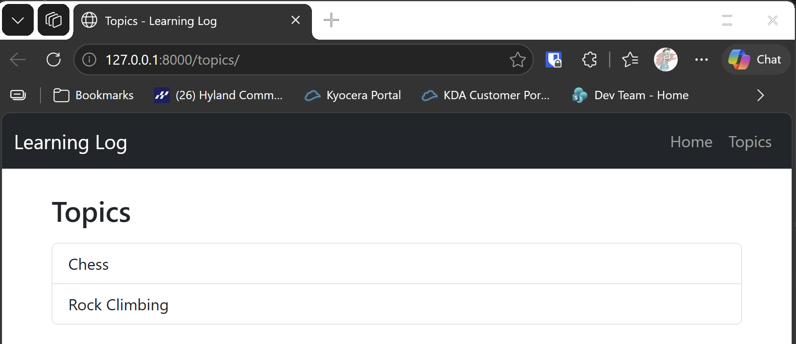

# Topics Page

## What this step does

The Learning Log now has a page that lists its topics. A route, `/topics/`, reads every topic from the database, oldest first, and passes them to
a template. The template loops over them and makes each one a row in a list group. The navigation bar gets a Topics link.

Each topic's row links to its own page, such as `/topics/1/`. That page is built in the next step, so the links don't open anything yet.

## If you're using the lesson runner

In the steps list, open **Part III · Beyond the Book**, then **S25 · Flask learning log**, then **Topics Page**, and click **Run**. The browser opens
at the topics page.

1. The list shows Chess and Rock Climbing.
2. The navigation bar has a Topics link, which opens this page from anywhere.

Press **Escape** to stop the server when you're done.

## For dummies: the quick version

1. In PowerShell, go to the `web-applications` folder.
2. Type `python build_stage.py s25 4 --run` and press Enter. You should see `Ran 13 tests` and `OK`.
3. Check the topics page for the two topics.
4. Press Ctrl+C to stop the server.

### Words you'll see

- **Query:** a request for rows from the database. `session.query(Topic).all()` asks for every topic.
- **`order_by`:** sorts the rows, here by the date they were added.
- **`with`:** closes the session when the block ends, even if something goes wrong.
- **`` and ``:** loop over a list in a template. `else` shows a message when the list has nothing in it. (Django calls this `empty`; Jinja uses `else`.)

## The code

The route reads the topics, then renders the template with them:

```python
@app.route("/topics/")
def topics() -> str:
    with app.extensions["session_factory"]() as session:
        all_topics = session.query(Topic).order_by(Topic.date_added).all()
        return render_template("topics.html", topics=all_topics)
```

The `with` block opens a session and closes it at the end. The template only reads each topic's text and id, so it doesn't need the session
after the block ends.

The template loops over the topics:

```html
<div class="list-group">
  
  <a class="list-group-item list-group-item-action" href="/topics/{{ topic.id }}/">{{ topic.text }}</a>
  
  <div class="list-group-item">No topics have been added yet.</div>
  
</div>
```

The link uses a fixed address for now, because the route for a single topic doesn't exist until the next step. In the next step, this can switch to
`url_for`, which builds the address from the route's name.

## Testing this step

The four tests in `tests/test_topics_page.py` check that the page loads, that it lists both topics, that each topic links to its page by id, and
that the navigation bar links to Topics. The build runs all 13 tests, the nine from earlier steps and these four.

## Output

The topics page with Chess and Rock Climbing.



## Changed files

- `flask_log/__init__.py`: the `/topics/` route
- `flask_log/templates/base.html`: the Topics link in the navigation bar
- `flask_log/templates/topics.html` (new): the list of topics
- `tests/test_topics_page.py` (new): tests for the topics page
