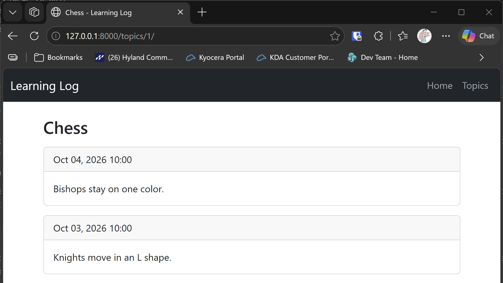

# Topic Page

## What this step does

Each topic now has its own page. The route `/topics/<id>/` reads one topic from the database, with its entries, and shows them in cards, newest
first. The number in the address is the topic's id, so `/topics/1/` is Chess.

A topic id that doesn't exist gives the 404 page, not an error. Flask's `abort(404)` stops the view and sends the page.

The topics list links to these pages with `url_for('topic', topic_id=...)`. That builds the address from the route's name, so the list no longer
has a fixed address for each topic.

## If you're using the lesson runner

In the steps list, open **Part III · Beyond the Book**, then **S25 · Flask learning log**, then **Topic Page**, and click **Run**. The browser opens
at the topics page.

1. Click **Chess**. The page shows its two entries, each in a card, with the date in the header.
2. Go to `http://127.0.0.1:8000/topics/9999/`. You should see the 404 page.

Press **Escape** to stop the server when you're done.

## For dummies: the quick version

1. In PowerShell, go to the `web-applications` folder.
2. Type `python build_stage.py s25 5 --run` and press Enter. You should see `Ran 17 tests` and `OK`.
3. Click Chess on the topics page, and check the two entries.
4. Press Ctrl+C to stop the server.

### Words you'll see

- **Route with a parameter:** `/topics/<int:topic_id>/` matches any whole number in that position, and passes it to the view as `topic_id`.
- **`session.get`:** looks up one row by its primary key. It returns `None` when there's no match.
- **`abort(404)`:** stops the view and sends the 404 page.
- **`url_for`:** builds an address from a route's name, and fills in its parameters.

## The code

The route looks up the topic, and gives the 404 page when it isn't there:

```python
@app.route("/topics/<int:topic_id>/")
def topic(topic_id: int) -> str:
    with app.extensions["session_factory"]() as session:
        topic_record = session.get(Topic, topic_id)
        if topic_record is None:
            abort(404)
        return render_template("topic.html", topic=topic_record)
```

`topic.entries` in the template gives the topic's entries. The relationship in `models.py` already sorts them newest first, so the template
doesn't need to sort them.

The template loops over the entries, with an `else` for a topic that has none:

```html

  <div class="card mb-3">
    <div class="card-header">{{ entry.date_added.strftime("%b %d, %Y %H:%M") }}</div>
    <div class="card-body">
      <p class="mb-0">{{ entry.text }}</p>
    </div>
  </div>

  <p>There are no entries for this topic yet.</p>

```

`strftime` formats a date in Python's date format, which the template can call directly.

## Testing this step

The four tests in `tests/test_topic_page.py` check that Chess's page loads, that it shows both entries, that a missing topic gives the 404 page, and
that the topics list links to each topic. The build runs all 17 tests, the 13 from earlier steps and these four.

## Output

The topic page for Chess, with its two entries.



## Changed files

- `flask_log/__init__.py`: the `/topics/<id>/` route
- `flask_log/templates/topic.html` (new): one topic and its entries
- `flask_log/templates/topics.html`: the links use `url_for`
- `tests/test_topic_page.py` (new): tests for the topic page

---
