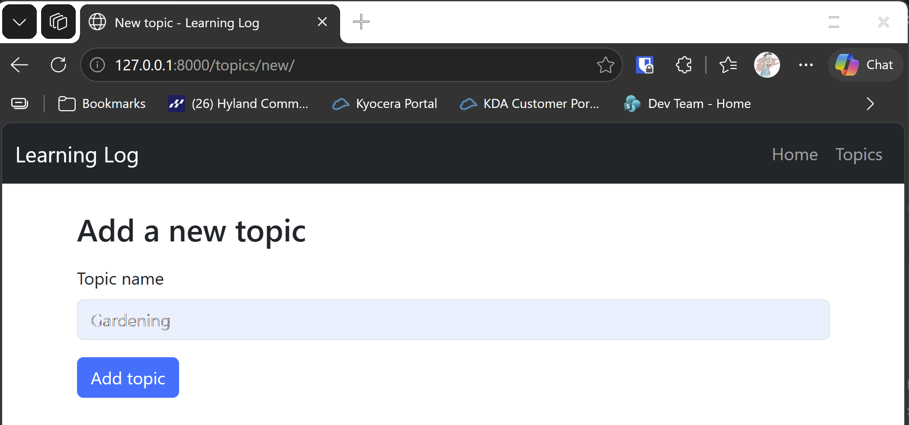

# New Topic Form

## What this step does

Learners can now add a topic. The page `/topics/new/` shows a form with one box for the name. When the form is sent, the route checks the name:

- **Empty names are refused.** Spaces count as empty, because the name is stripped first.
- **Names over 200 characters are refused.** That matches the length of the `text` column.
- **Duplicate names are refused.** A name that matches an existing topic, ignoring capital letters, is not saved. So `chess` clashes with `Chess`.

If a check fails, the form comes back with the message and the text still in the box, so the learner can correct it. If the name passes, the topic is
saved and the browser goes back to the topics list.

Flask doesn't include a form library, so this step writes the form and the checks by hand. The Django chapter used a form class to do this.

## If you're using the lesson runner

In the steps list, open **Part III · Beyond the Book**, then **S25 · Flask learning log**, then **New Topic Form**, and click **Run**. The browser opens at
the new topic form.

1. Type `chess` and click **Add topic**. The form stays, with the message **A topic with this name already exists.**
2. Type `Gardening` and click **Add topic**. You land on the topics list, with Gardening in it.

Press **Escape** to stop the server when you're done.

## For dummies: the quick version

1. In PowerShell, go to the `web-applications` folder.
2. Type `python build_stage.py s25 6 --run` and press Enter. You should see `Ran 21 tests` and `OK`.
3. Try the two names above on the form.
4. Press Ctrl+C to stop the server.

### Words you'll see

- **`methods=["GET", "POST"]`:** the route answers both kinds of request. GET shows the empty form, and POST receives what was typed.
- **`request.form`:** the values sent with a form. `request.form.get("text", "")` reads the box, or gives an empty string if it's missing.
- **`func.lower`:** SQLAlchemy's way to lowercase a column in the query. Comparing lowercased values ignores capital letters.
- **`redirect` and `url_for`:** send the browser to another page. Here it goes back to the topics list.

## The code

The route handles both requests:

```python
@app.route("/topics/new/", methods=["GET", "POST"])
def new_topic() -> str:
    error = None
    text = ""
    if request.method == "POST":
        text = request.form.get("text", "").strip()
        with app.extensions["session_factory"]() as session:
            error = topic_name_error(session, text)
            if error is None:
                session.add(Topic(text=text))
                session.commit()
                return redirect(url_for("topics"))
    return render_template("new_topic.html", error=error, text=text)
```

The checks live in one function, so the rules are in one place:

```python
def topic_name_error(session, text: str) -> str | None:
    if not text:
        return "Please enter a topic name."
    if len(text) > MAX_TOPIC_LENGTH:
        return f"Topic names can be at most {MAX_TOPIC_LENGTH} characters."
    if session.query(Topic).filter(func.lower(Topic.text) == text.lower()).first() is not None:
        return "A topic with this name already exists."
    return None
```

The function returns the message for the first check that fails, or `None` when the name is fine. Returning a message, rather than raising an error, makes it
easy to test.

The template shows the message, if there is one, and keeps the text in the box:

```html
<input type="text" class="form-control" id="text" name="text" maxlength="200" value="{{ text }}">
```

Jinja escapes the value automatically, so text that looks like HTML is shown as text.

## Testing this step

The four tests in `tests/test_new_topic.py` check that the form loads, that a valid name is saved and redirects to the list, that an empty name is refused,
and that a name differing only in capitals is refused. The build runs all 21 tests, the 17 from earlier steps and these four.

## Output

The new topic form, showing the duplicate message after `chess` is entered.



## Changed files

- `flask_log/__init__.py`: the `/topics/new/` route, and the `topic_name_error` check
- `flask_log/templates/new_topic.html` (new): the form
- `flask_log/templates/topics.html`: an Add a new topic button
- `tests/test_new_topic.py` (new): tests for the form and its checks
