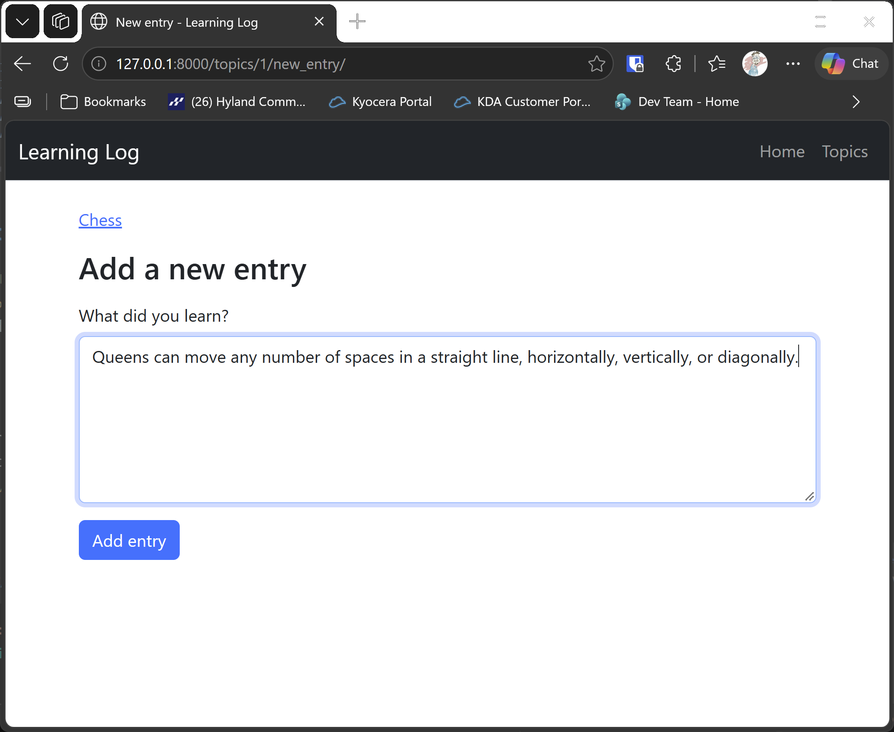

# New Entry Form

## What this step does

Each topic can now have new entries. The page `/topics/<id>/new_entry/` shows a form with a text box, and the topic page has an Add new entry link to it.
When the form is sent, the route checks the text. A blank entry is refused, with a message, and the text stays in the box. A valid entry is saved under the
topic, and the browser goes back to the topic page, where the new entry appears first.

If the topic doesn't exist, the form page gives the 404 page. The check happens before anything else, so a missing topic never shows a form.

## If you're using the lesson runner

In the steps list, open **Part III · Beyond the Book**, then **S25 · Flask learning log**, then **New Entry Form**, and click **Run**. The browser opens at Chess.

1. Click **Add new entry**, type `Pawns move forward.`, and click **Add entry**. You return to Chess, with three entries.
2. Open **Add new entry** again, leave the box empty, and click **Add entry**. The message **Please write something for this entry.** appears.

Press **Escape** to stop the server when you're done.

## For dummies: the quick version

1. In PowerShell, go to the `web-applications` folder.
2. Type `python build_stage.py s25 7 --run` and press Enter. You should see `Ran 26 tests` and `OK`.
3. Add an entry to Chess, and try a blank one.
4. Press Ctrl+C to stop the server.

### Words you'll see

- **`<textarea>`:** a box for several lines of text. The form sends its text under the name `text`.
- **`session.add` and `commit`:** add the new entry to the session, then save it to the database.
- **Route with a parameter:** `/topics/<int:topic_id>/new_entry/` gives the view the topic's id, so the entry is linked to the right topic.

## The code

The route looks up the topic first, so a missing topic gives the 404 page:

```python
@app.route("/topics/<int:topic_id>/new_entry/", methods=["GET", "POST"])
def new_entry(topic_id: int) -> str:
    error = None
    text = ""
    with app.extensions["session_factory"]() as session:
        topic_record = session.get(Topic, topic_id)
        if topic_record is None:
            abort(404)
        if request.method == "POST":
            text = request.form.get("text", "").strip()
            error = entry_text_error(text)
            if error is None:
                session.add(Entry(topic_id=topic_id, text=text))
                session.commit()
                return redirect(url_for("topic", topic_id=topic_id))
        return render_template("new_entry.html", topic=topic_record, error=error, text=text)
```

The check is simple, and it lives in its own function, like the topic-name check in the previous step:

```python
def entry_text_error(text: str) -> str | None:
    if not text:
        return "Please write something for this entry."
    return None
```

The form's action is built with `url_for`, so it always points at the right topic:

```html
<form method="post" action="{{ url_for('new_entry', topic_id=topic.id) }}">
```

## Testing this step

The five tests in `tests/test_new_entry.py` check that the form loads, that a valid entry is saved under Chess and the browser is sent back, that a blank
entry is refused, that a missing topic gives the 404 page, and that the topic page links to the form. The build runs all 26 tests, the 21 from earlier steps
and these five.

## Output

The Chess topic page, with the Add new entry link.



## Changed files

- `flask_log/__init__.py`: the `/topics/<id>/new_entry/` route, and the `entry_text_error` check
- `flask_log/templates/new_entry.html` (new): the form
- `flask_log/templates/topic.html`: the Add new entry link
- `tests/test_new_entry.py` (new): tests for the form and its checks

---
