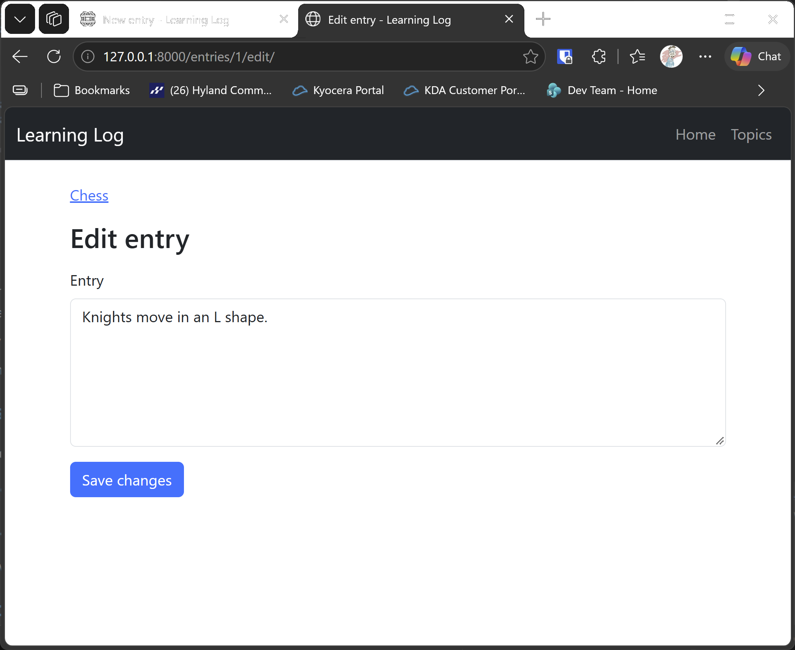

# Edit Entry

## What this step does

Each entry on a topic page now has an Edit entry link. The link opens `/entries/<id>/edit/`, a form filled in with the entry's current text. The form
uses the same blank check as the new entry form. A valid change is saved, and the browser goes back to the topic.

The change is made on the entry itself, not by deleting and adding a new one, so the entry keeps its id and its date.

If the entry doesn't exist, the form page gives the 404 page.

## If you're using the lesson runner

In the steps list, open **Part III · Beyond the Book**, then **S25 · Flask learning log**, then **Edit Entry**, and click **Run**. The browser opens at Chess.

1. Click **Edit entry** on the Knights entry. Change the text so it ends with `an L.`, and click **Save changes**. You return to Chess, and the entry shows the new text.
2. Open **Edit entry** again, clear the box, and click **Save changes**. The message **Please write something for this entry.** appears.

Press **Escape** to stop the server when you're done.

## For dummies: the quick version

1. In PowerShell, go to the `web-applications` folder.
2. Type `python build_stage.py s25 8 --run` and press Enter. You should see `Ran 31 tests` and `OK`.
3. Edit the Knights entry, and try a blank edit.
4. Press Ctrl+C to stop the server.

### Words you'll see

- **Editing an existing row:** the route loads the entry, changes its `text`, and commits. SQLAlchemy notices the change, so no `add` is needed.
- **Pre-filled form:** the text box starts with the entry's current text, so the learner changes only what they need to.

## The code

The route loads the entry, and changes its text only when the new text passes the check:

```python
@app.route("/entries/<int:entry_id>/edit/", methods=["GET", "POST"])
def edit_entry(entry_id: int) -> str:
    error = None
    with app.extensions["session_factory"]() as session:
        entry_record = session.get(Entry, entry_id)
        if entry_record is None:
            abort(404)
        text = entry_record.text
        if request.method == "POST":
            text = request.form.get("text", "").strip()
            error = entry_text_error(text)
            if error is None:
                entry_record.text = text
                session.commit()
                return redirect(url_for("topic", topic_id=entry_record.topic_id))
        return render_template("edit_entry.html", entry=entry_record, error=error, text=text)
```

On a GET request, `text` is the entry's current text, so the form starts filled in. On a POST, it's what the learner typed.

Setting `entry_record.text` is all that's needed to change the row. `commit` saves it.

The entry's topic is used for the back link, so the form stays inside the same session while it's rendered.

## Testing this step

The five tests in `tests/test_edit_entry.py` check that the form shows the current text, that a valid edit is saved and sends the browser back to the topic,
that a blank edit is refused without changing the entry, that a missing entry gives the 404 page, and that the topic page links to the edit form. The build runs
all 31 tests, the 26 from earlier steps and these five.

## Output

The edit form, with the Knights entry's text in the box.



## Changed files

- `flask_log/__init__.py`: the `/entries/<id>/edit/` route
- `flask_log/templates/edit_entry.html` (new): the edit form
- `flask_log/templates/topic.html`: an Edit entry link for each entry
- `tests/test_edit_entry.py` (new): tests for the edit form
