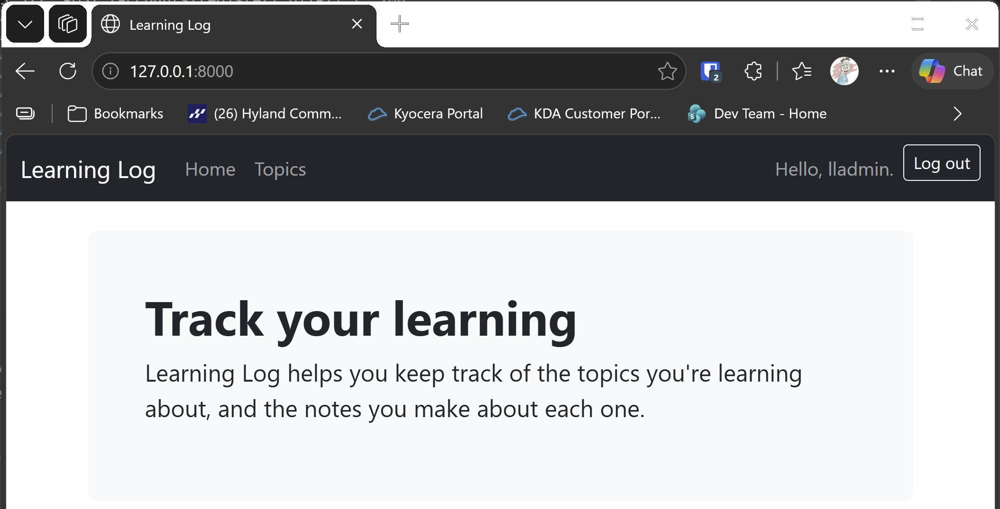

# Accounts

## What this step does

Learning Log now has accounts. A visitor can register, log in and log out. The navigation bar shows the signed-in user's name, with a Log out button, or
the Log in and Register links when nobody is signed in.

The build also creates the admin account, from the two environment variables the runner sets. The `create-admin` command is no longer a placeholder: it
makes the account, or says so if it already exists. The seed data in later steps depends on that account existing first.

Flask keeps the signed-in user in the session, which is stored in a cookie. The cookie is signed with the app's secret key, so it can't be changed by
hand. Passwords are never stored: the database keeps a hash, made by Werkzeug, and a login checks the password against that hash.

## If you're using the lesson runner

In the steps list, open **Part III · Beyond the Book**, then **S25 · Flask learning log**, then **Accounts**, and click **Run**. The build creates your admin
account, so the runner's account is already there. The browser opens at the home page.

1. Click **Log in**, and sign in with the account from the runner. The bar says **Hello**, followed by your username.
2. Click **Log out**. The bar shows **Log in** and **Register** again.
3. Click **Register**, and make a second account. You're signed in straight away.

Press **Escape** to stop the server when you're done.

## For dummies: the quick version

1. In PowerShell, go to the `web-applications` folder.
2. Type `python build_stage.py s25 9 --run` and press Enter. You should see `Admin account ... created.` and `Ran 39 tests` and `OK`.
3. Sign in, sign out, and register a second account.
4. Press Ctrl+C to stop the server.

### Words you'll see

- **Session:** Flask's record of who is signed in. It's kept in a cookie, signed with the secret key.
- **Password hash:** a scrambled form of a password, made with `generate_password_hash`. `check_password_hash` tells you whether a password matches it.
- **Blueprint:** a group of routes with a shared prefix. The accounts routes all live under `/accounts/`.
- **Context processor:** a function that adds values to every template. Here it adds `current_username`, so the navigation bar can greet the user.

## The code

The `User` table keeps a hash, never the password:

```python
class User(Base):
    __tablename__ = "users"

    id: Mapped[int] = mapped_column(primary_key=True)
    username: Mapped[str] = mapped_column(String(50), unique=True)
    password_hash: Mapped[str] = mapped_column(String(255))

    def set_password(self, password: str) -> None:
        self.password_hash = generate_password_hash(password)

    def check_password(self, password: str) -> bool:
        return check_password_hash(self.password_hash, password)
```

Logging in checks the password, then stores the user's id in the session:

```python
user = db.query(User).filter_by(username=username).first()
if user is not None and user.check_password(password):
    flask_session["user_id"] = user.id
    return redirect(url_for("index"))
```

The error message is the same for an unknown username and a wrong password. That stops the form from revealing which usernames exist.

Logging out clears the session:

```python
@accounts.route("/logout/", methods=["POST"])
def logout() -> str:
    flask_session.clear()
    return redirect(url_for("index"))
```

The context processor reads the session on every request and makes the name available to all templates:

```python
@app.context_processor
def inject_current_user() -> dict:
    user_id = flask_session.get("user_id")
    username = None
    if user_id is not None:
        with app.extensions["session_factory"]() as db:
            user = db.get(User, user_id)
            username = user.username if user is not None else None
    return {"current_username": username}
```

`session as flask_session` in the imports is deliberate. The name `session` is already used for the database session in the views, so Flask's session gets its own name.

## Testing this step

The eight tests in `tests/test_accounts.py` check that the register page loads, that registering signs the new user in, that mismatched passwords are refused,
that the right password logs in, that a wrong password is refused, that logging out clears the session, that the navigation bar shows the name, and that the
admin command makes its account from the environment. The build runs all 39 tests, the 31 from earlier steps and these eight.

## Output

The navigation bar when signed out, and after signing in.



## Changed files

- `flask_log/models.py`: adds the `User` table, with password hashing
- `flask_log/accounts.py` (new): the register, log in and log out routes
- `flask_log/__init__.py`: the secret key, the accounts blueprint, the context processor, and a real `create-admin` command
- `flask_log/templates/base.html`: the signed-in name and Log out button, or the sign-in links
- `flask_log/templates/accounts/login.html` (new): the log in form
- `flask_log/templates/accounts/register.html` (new): the register form
- `tests/test_accounts.py` (new): tests for accounts
