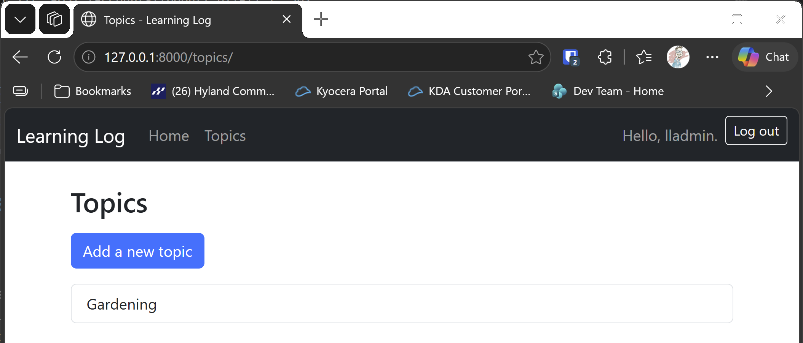

# Ownership and Restricted Access

## What this step does

Each topic now belongs to the user who created it, and each user sees only their own topics. The topics list, the topic page, and the new topic, new entry
and edit pages all require sign-in. A visitor who isn't signed in is sent to the login page, and the page they wanted is remembered, so logging in brings
them back to it.

A signed-in user who asks for someone else's topic, or an entry inside someone else's topic, gets the 404 page. That's the same page as for a topic that
doesn't exist, so the app doesn't reveal that the topic is there.

Topic names are now unique for each user. Two users can each have a topic called Chess, but one user can't have two with the same name, whatever the capital
letters.

## If you're using the lesson runner

In the steps list, open **Part III · Beyond the Book**, then **S25 · Flask learning log**, then **Ownership and Restricted Access**, and click **Run**. The
browser opens at the login page.

1. Sign in with the runner's account. The topics page shows Chess and Rock Climbing.
2. Log out, then go to `http://127.0.0.1:8000/topics/`. You're sent to the login page.
3. Register a second account. Its topics page is empty. `http://127.0.0.1:8000/topics/1/` gives the 404 page.

Press **Escape** to stop the server when you're done.

## For dummies: the quick version

1. In PowerShell, go to the `web-applications` folder.
2. Type `python build_stage.py s25 10 --run` and press Enter. You should see `Ran 44 tests` and `OK`.
3. Run the three checks above.
4. Press Ctrl+C to stop the server.

### Words you'll see

- **`login_required`:** a decorator that runs before the view. If nobody is signed in, it redirects to the login page instead.
- **`owner_id`:** the id of the user a topic belongs to. A `ForeignKey` links it to the `users` table.
- **`UniqueConstraint`:** a database rule that stops two rows having the same values in the named columns. Here, `owner_id` and `text` together.
- **The `next` address:** the page the visitor wanted. It's kept in the login form, so after signing in they go back to it.

## The code

`login_required` is a decorator, which means a function that wraps another function:

```python
def login_required(view):
    @wraps(view)
    def wrapper(*args, **kwargs):
        if current_user_id() is None:
            return redirect(url_for("accounts.login", next=request.path))
        return view(*args, **kwargs)
    return wrapper
```

`@wraps(view)` keeps the view's name, so Flask can still tell the routes apart. A route is decorated with `@app.route` first, then `@login_required`, so
the check runs on every request to that route.

The topic route only shows topics the user owns, and any other topic gets a 404:

```python
topic_record = session.get(Topic, topic_id)
if topic_record is None or topic_record.owner_id != current_user_id():
    abort(404)
```

Checking for a missing topic and for someone else's topic in the same `if` means both get the same response. That's deliberate.

The topics list asks the database only for the user's topics:

```python
my_topics = session.query(Topic).filter_by(owner_id=current_user_id()).order_by(Topic.date_added).all()
```

The uniqueness rule lives in two places. The check in `topic_name_error` gives a friendly message. The `UniqueConstraint` in `models.py` is the database's own rule, which holds even if the check is bypassed:

```python
__table_args__ = (UniqueConstraint("owner_id", "text", name="unique_topic_per_owner"),)
```

`safe_next` makes sure the `next` address points inside this site. A value like `https://elsewhere.example` is ignored, so the login form can't be used to send visitors to another site.

## Testing this step

The new file `tests/test_ownership.py` has five tests. They check that the topics list needs sign-in, that each user sees only their own topics, that another
user's topic gives a 404, that another user can't add an entry, and that two users can use the same topic name. The other test files now sign in before they
open a topic page. The build runs all 44 tests: the 39 from earlier steps, and five new ones.

## Output

The topics page for the runner's account, showing Chess and Rock Climbing.



## Changed files

- `flask_log/models.py`: `Topic` gets an owner and the per-user unique rule
- `flask_log/accounts.py`: `login_required`, `current_user_id`, the `next` address, and `safe_next`
- `flask_log/__init__.py`: the restricted routes, the per-user name check, and the seed loader's owner
- `flask_log/templates/accounts/login.html`: carries the `next` address through the form
- `seed.json`: the example topics, owned by user 1
- `tests/test_ownership.py` (new): tests for ownership and restricted access
- `tests/test_models.py`, `tests/test_topics_page.py`, `tests/test_topic_page.py`, `tests/test_new_topic.py`, `tests/test_new_entry.py`, `tests/test_edit_entry.py`: each signs in first
