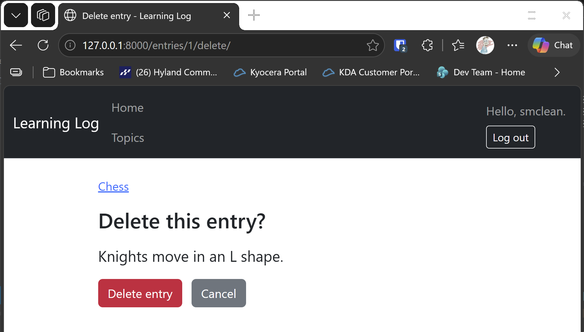

# Deleting Entries

## What this step does

Each entry on a topic page now has a Delete entry link. The link opens a confirmation page, which shows the entry and asks whether to delete it. The entry is
removed only when the learner presses the Delete entry button on that page. Cancel goes back to the topic, and nothing changes.

Only the owner of the topic can delete its entries. Anyone else gets the 404 page, and a visitor who isn't signed in is sent to the login page.

The delete happens on a POST request, not a GET. A link can open the confirmation page, but it can't delete anything by itself. That's why a link on another site, or a
loaded image, can't remove an entry.

## If you're using the lesson runner

In the steps list, open **Part III · Beyond the Book**, then **S25 · Flask learning log**, then **Deleting Entries**, and click **Run**. The login page opens first.

1. Sign in with the runner's account. You return to Chess.
2. Click **Delete entry** on the Bishops entry. The confirmation page shows the entry, with the Delete entry button and Cancel.
3. Click **Cancel**, then delete the entry for real, and confirm. You're back on Chess, with one entry left.

Press **Escape** to stop the server when you're done.

## For dummies: the quick version

1. In PowerShell, go to the `web-applications` folder.
2. Type `python build_stage.py s25 11 --run` and press Enter. You should see `Ran 49 tests` and `OK`.
3. Delete one entry, using the confirmation page.
4. Press Ctrl+C to stop the server.

### Words you'll see

- **Confirmation page:** a page that asks before something is removed. It stops a stray click from deleting data.
- **POST request:** the kind of request a form sends. Deleting only happens on a POST.
- **`session.delete`:** marks a row to be removed. `commit` removes it from the database.

## The code

The route shows the confirmation page on GET, and deletes on POST:

```python
@app.route("/entries/<int:entry_id>/delete/", methods=["GET", "POST"])
@login_required
def delete_entry(entry_id: int) -> str:
    with app.extensions["session_factory"]() as session:
        entry_record = session.get(Entry, entry_id)
        if entry_record is None or entry_record.topic.owner_id != current_user_id():
            abort(404)
        topic_id = entry_record.topic_id
        if request.method == "POST":
            session.delete(entry_record)
            session.commit()
            return redirect(url_for("topic", topic_id=topic_id))
        return render_template("delete_entry.html", entry=entry_record)
```

The owner check comes before anything else, so a user who doesn't own the topic gets the 404 page for both the confirmation and the delete. The topic id is
kept before the entry is removed, so the redirect back to the topic still works.

The form on the confirmation page sends a POST:

```html
<form method="post" action="{{ url_for('delete_entry', entry_id=entry.id) }}" class="d-inline">
  <button type="submit" class="btn btn-danger">Delete entry</button>
</form>
```

The form is a POST, so only the button can delete the entry. The Cancel link is a plain link back to the topic.

## Testing this step

The five tests in `tests/test_delete_entry.py` check that the confirmation page loads without deleting, that the owner's confirmation removes the entry, that
another user gets the 404 page and the entry stays, that the topic page links to the delete page, and that a visitor who isn't signed in is sent to log in.
The build runs all 49 tests, the 44 from earlier steps and these five.

## Output

The confirmation page for an entry, with the Delete entry and Cancel buttons.



## Changed files

- `flask_log/__init__.py`: the `/entries/<id>/delete/` route
- `flask_log/templates/delete_entry.html` (new): the confirmation page
- `flask_log/templates/topic.html`: a Delete entry link beside each Edit entry link
- `tests/test_delete_entry.py` (new): tests for deleting entries
