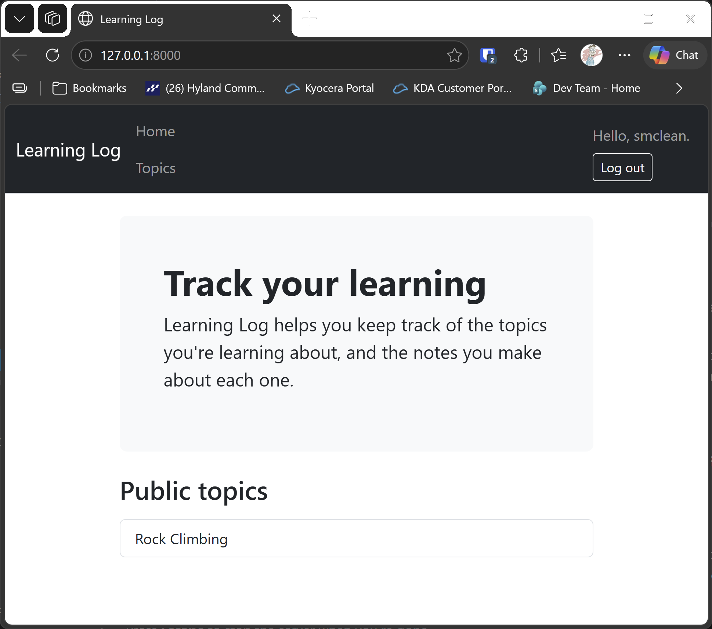

# Public Topics

## What this step does

A topic can now be public. When an owner ticks **Make this topic public** on the new topic form, anyone can read the topic, including visitors who aren't
signed in. Public topics also appear in a Public topics list on the home page.

Public is a read-only setting for everyone else. Only the owner can add, edit or delete entries, and the owner's links appear only to the owner. A
private topic works as before: a visitor who isn't signed in is sent to the login page, and any other user gets the 404 page.

## If you're using the lesson runner

In the steps list, open **Part III · Beyond the Book**, then **S25 · Flask learning log**, then **Public Topics**, and click **Run**. The browser opens at the
home page, which needs no sign-in.

1. The Public topics list shows **Rock Climbing**, but not Chess.
2. Click **Rock Climbing**. It opens without signing in, and has a Public badge, but no Add new entry link.
3. Sign in with the runner's account, and open **Chess**. It's private, but you own it, so you can open it.
4. Click **Add a new topic**, type `Gardening`, tick **Make this topic public**, and click **Add topic**. Log out, and check that Gardening appears on the home page.

Press **Escape** to stop the server when you're done.

## For dummies: the quick version

1. In PowerShell, go to the `web-applications` folder.
2. Type `python build_stage.py s25 12 --run` and press Enter. You should see `Ran 55 tests` and `OK`.
3. Check the public and private topics as in the steps above.
4. Press Ctrl+C to stop the server.

### Words you'll see

- **Public flag:** a `Boolean` column on the topic. It's `False` unless the owner ticks the box.
- **Read-only for others:** the owner-only links are wrapped in ``, so they only appear to the owner.
- **`redirect` and `abort`:** a visitor who isn't signed in is redirected to log in, and another signed-in user gets a 404.

## The code

The topic route decides who may read the topic:

```python
@app.route("/topics/<int:topic_id>/")
def topic(topic_id: int) -> str:
    with app.extensions["session_factory"]() as session:
        topic_record = session.get(Topic, topic_id)
        if topic_record is None:
            abort(404)
        is_owner = current_user_id() == topic_record.owner_id
        if not topic_record.public and not is_owner:
            if current_user_id() is None:
                return redirect(url_for("accounts.login", next=request.path))
            abort(404)
        return render_template("topic.html", topic=topic_record, is_owner=is_owner)
```

Public topics skip the check. A private topic is shown only to its owner. The route is no longer behind `login_required`, because a public topic must be
readable without signing in. The sign-in check moved inside the route.

The home page lists the public topics:

```python
public_topics = session.query(Topic).filter_by(public=True).order_by(Topic.date_added).all()
```

The form reads the checkbox. An unticked box isn't sent at all, so the value is `None`, and the check is `== "on"`:

```python
is_public = request.form.get("public") == "on"
```

The template shows the owner-only links only to the owner:

```html

  <a class="btn btn-primary btn-sm mb-3" href="{{ url_for('new_entry', topic_id=topic.id) }}">Add new entry</a>

```

## Testing this step

The six tests in `tests/test_public.py` check that a new topic is private unless the box is ticked, that ticking it makes the topic public, that a visitor who
isn't signed in can read a public topic, that a private topic sends them to log in, that the home page lists public topics, and that another user sees a public
topic without the owner's controls. The setup and layout tests now create their tables, because the home page reads them. The build runs all 55 tests.

## Output

A public topic, read by a visitor who isn't signed in.



## Changed files

- `flask_log/models.py`: the `public` flag on `Topic`
- `flask_log/__init__.py`: the home page lists public topics, the topic route allows public reads, the form saves the checkbox, and the seed loader reads the flag
- `flask_log/templates/index.html`: the Public topics list
- `flask_log/templates/topic.html`: the Public badge, and the owner-only links
- `flask_log/templates/new_topic.html`: the Public checkbox
- `seed.json`: Rock Climbing is public
- `tests/test_public.py` (new): tests for public topics
- `tests/test_setup.py`, `tests/test_layout.py`: create their tables, because the home page reads them

---
