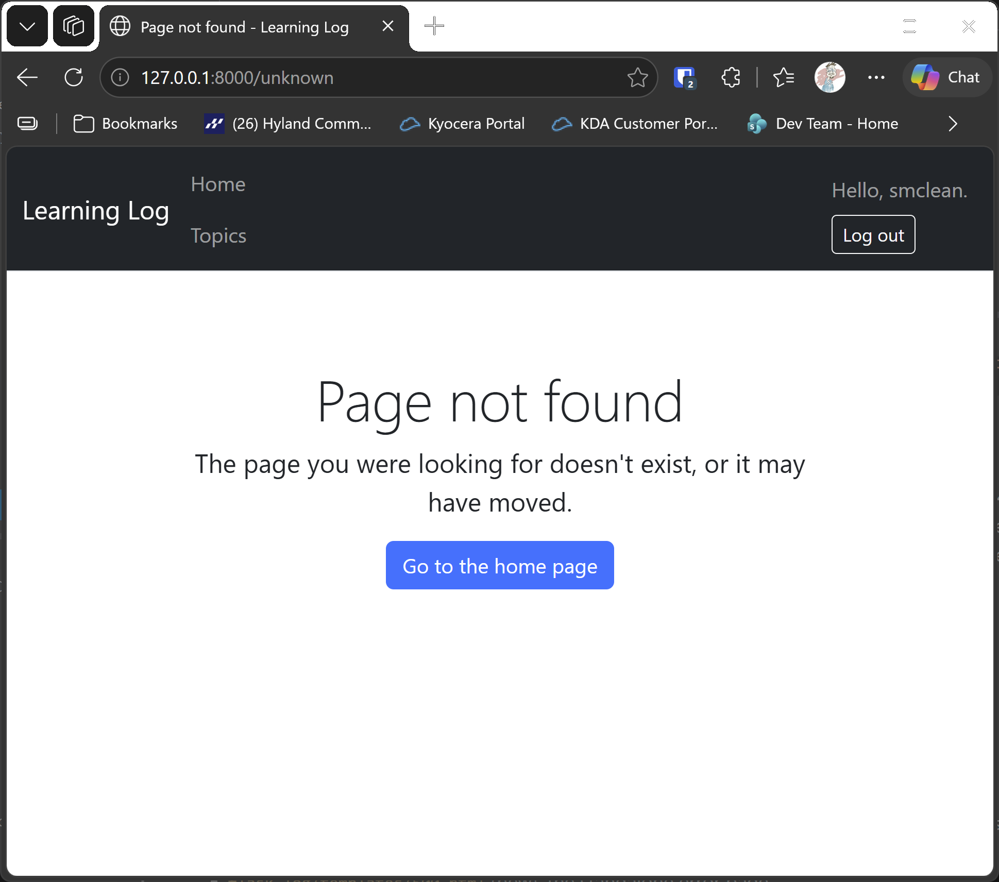

# Production Readiness

## What this step does

The Learning Log works on your own computer, but a live site needs a few things set differently. This step makes the app ready for that, without deploying it.
Deployment is covered in the Django chapter's PythonAnywhere lesson, and it works the same way for this app.

Five things change:

- **Settings come from the environment.** The secret key, the database address and debug mode are read from `LL_SECRET_KEY`, `DATABASE_URL` and `LL_DEBUG`. A live
  site sets them. Your computer uses the defaults, so nothing changes for you.
- **Debug mode is off on a live site.** Debug mode shows detailed errors, which helps while building but would show too much to visitors. `LL_DEBUG` set to `0`
  turns it off.
- **The session cookie is secure when debug is off.** A secure cookie is sent only over HTTPS. Locally the site runs over plain HTTP, so the setting is off while
  debugging.
- **A friendly 404 page.** An address that doesn't exist shows the Learning Log page with a way back home. This page is shown locally too.
- **A friendly 500 page, when debug is off.** An unexpected error shows a plain message. With debug on, Flask shows the traceback instead, which is what you want while
  building.

The step also adds a `check-settings` command. It lists anything that isn't ready for a live site. It changes nothing: you fix the settings, then run it again.

## If you're using the lesson runner

In the steps list, open **Part III · Beyond the Book**, then **S25 · Flask learning log**, then **Production Readiness**, and click **Run**. The browser opens at the home page.

1. Go to `http://127.0.0.1:8000/no-such-page/`. You see the friendly **Page not found** page, with a button back home.
2. Open a second PowerShell window in the `web-applications` folder, and run the two lines below. The first moves into the build folder, and the second runs the check:

   ```pwsh
   cd build\s25-flask-learning-log-step-13
   ..\..\.venv\Scripts\python.exe -m flask --app flask_app check-settings
   ```

   It lists three problems. These are expected locally, because debug mode is on and no secret key is set.

Press **Escape** to stop the server when you're done.

## For dummies: the quick version

1. In PowerShell, go to the `web-applications` folder.
2. Type `python build_stage.py s25 13 --run` and press Enter. You should see `Ran 62 tests` and `OK`.
3. Check the friendly 404 page, and run `check-settings` from the build folder.
4. Press Ctrl+C to stop the server.

### Words you'll see

- **`LL_DEBUG`:** the switch for debug mode. `1` is on, which is the local default, and `0` is off, which a live site uses.
- **`DATABASE_URL`:** the connection string for the database. The default is a SQLite file. A SQL Server or MySQL string goes here instead.
- **Secure cookie:** a cookie marked so the browser sends it only over HTTPS.
- **Error handler:** a function that Flask runs when a given error happens, such as `@app.errorhandler(404)`.

## The code

The settings are read from the environment, with the local values as defaults:

```python
app.config["SECRET_KEY"] = os.environ.get("LL_SECRET_KEY", DEFAULT_SECRET_KEY)
app.config["DEBUG"] = os.environ.get("LL_DEBUG", "1") == "1"
app.config["SESSION_COOKIE_SECURE"] = not app.config["DEBUG"]
```

The cookie is secure only when debug is off. That follows from the same switch, so there's one place to change.

The error handlers show the friendly pages:

```python
@app.errorhandler(404)
def page_not_found(error):
    return render_template("404.html"), 404

@app.errorhandler(500)
def server_error(error):
    return render_template("500.html"), 500
```

The 404 page extends the shared layout, so it has the navigation bar. The 500 page stands alone. It doesn't use the layout, because the layout needs the
request to work, and a 500 error can happen before the request has finished.

Flask shows the 500 handler's page only when debug is off. With debug on, an unexpected error reaches the debugger, with the traceback. That's why the handler
can be registered without changing how errors look while you build.

The `check-settings` command tests the same switches, and prints a line for each problem:

```python
if app.config["SECRET_KEY"] == DEFAULT_SECRET_KEY:
    problems.append("LL_SECRET_KEY isn't set, so the default secret key is in use.")
if app.debug:
    problems.append("Debug mode is on. Set LL_DEBUG to 0 before the site goes live.")
```

## Testing this step

The seven tests in `tests/test_production.py` check that an unknown address gets the friendly 404 page, that an unexpected error gets the friendly 500 page when debug
is off, that the secret key and the database address come from the environment, that the cookie is secure only when debug is off, and that `check-settings` reports
problems and says when the site is ready. The build runs all 62 tests.

## Output

The friendly 404 page, as a learner sees it.



## Changed files

- `flask_log/__init__.py`: the environment settings, the secure cookie, the two error handlers, and the `check-settings` command
- `flask_log/templates/404.html` (new): the friendly 404 page, in the shared layout
- `flask_log/templates/500.html` (new): the standalone error page
- `tests/test_production.py` (new): tests for production readiness
